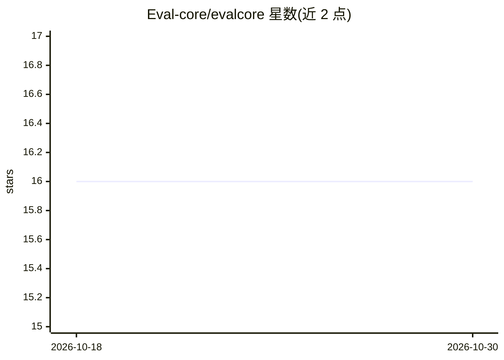

# Eval-core/evalcore

⭐ 16 · Rust · Apache-2.0 · 推送 2026-07-26 · [GitHub](https://github.com/Eval-core/evalcore) · [官网](https://evalcore.cc/) · 组织维护

**本地优先的 LLM 应用与 Agent 快照测试评测运行器**

单二进制的 LLM 应用与 agent 评测运行器：用 YAML 定义用例与打分规则、JSONL 存放数据集，可测试 shell 命令、HTTP API、OpenAI 兼容端点、anthropic/gemini 目标及 OTel/OpenInference trace。核心机制是 record/replay 缓存：录制模型、API、judge 与 embedding 调用后离线重放，无需网络与 API key，退出码 0/1 用于在 CI 中拦截回归。支持基线对比、多次试验统计、成本预算与 HTML/JUnit 报告。项目处于 pre-1.0，配置与 CLI 细节可能在次版本间变化。通过 cargo 安装或下载 Linux/macOS 预编译二进制。

## 筛选速览

| 维度 | 判定 | 备注 |
|---|---|---|
| AI 角色 | `ai-ecosystem` | LLM/agent 周边工具 |
| 许可风险 | `permissive` | Apache-2.0 |
| 部署形态 | `library` | 以包/库形式分发 |
| 模型依赖 | — | README 未给出锁定关系 |
| 硬件要求 | — | 无带数字的原话,不猜 |
| 安装摩擦 | `low` | 无编译、无系统依赖或容器化 |
| 成熟度 | `idea` | |

## 能力要点

- YAML+JSONL 定义用例与打分，退出码 0/1 直接作为 PR 门禁
- record/replay 缓存离线重放，无需网络与 API key，无模型方差
- 覆盖 shell/http/openai-compatible/anthropic/gemini/trace 目标与多种打分器（含 judge、json-schema、similarity）
- 基线对比、试验统计、成本预算与 HTML/JUnit/终端报告

## 适用场景

- 在 CI 中拦截 LLM 应用与 agent 的行为回归
- 离线重放评测用例，避免 PR 检查引入模型方差与 API 费用
- 对比不同模型、提示词或端点的输出表现
- 对 RAG 回答按检索证据评分并生成可审阅报告

## 场景标签

`模型评测` · 领域:评测与运维

## 证据(README 行号)

> L27: EvalCore is a single-binary eval runner for LLM applications and agents. Define
> L33: - **Repeatable CI.** Record cacheable model, API, judge, and embedding calls once;

## 星数曲线

2026-10-18 16 → 2026-10-30 16（+0）

---
*卡片 v1 · prompt 1.4 · 生成 2026-10-30 · 置信度 high · 依据 README sha `a0ec8b8c81d0` · [字段定义](../../DATASET.md)*
