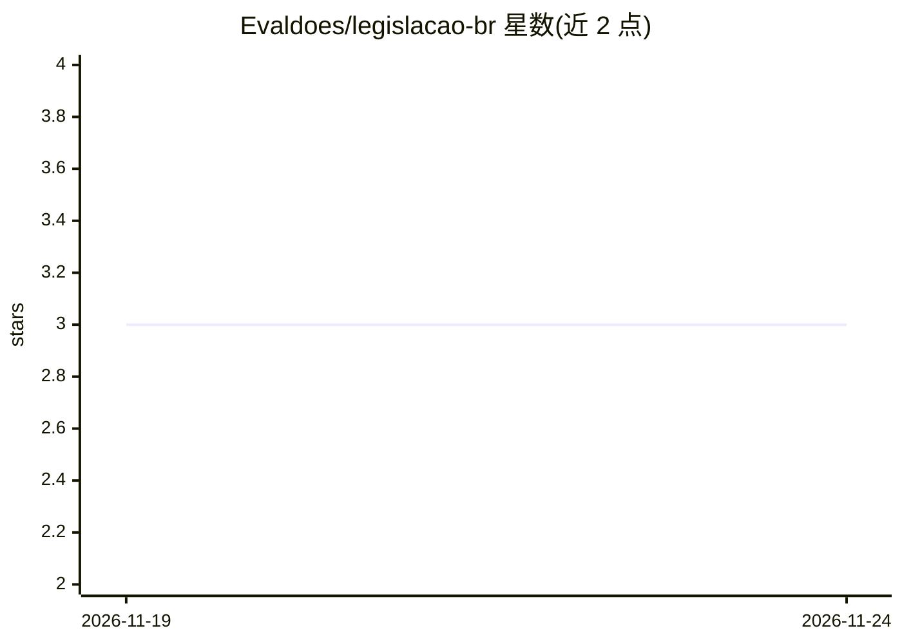

# Evaldoes/legislacao-br

⭐ 3 · TypeScript · CC0-1.0 · 推送 2026-11-09 · [GitHub](https://github.com/Evaldoes/legislacao-br) · 个人维护

**为开发者提供 Markdown+Git 版本化的巴西联邦法律文本数据集**

将巴西联邦法律（宪法、CLT、消费者法等，截至当前 4 部可用、4 部规划中）逐条拆为 Markdown 文件，配 YAML frontmatter 元数据（稳定 id、层级、来源 URL、修订注释），用 Git 记录每条修订历史。文本由仓库内 ingestion 程序自动从 Planalto 官网抓取清洗，GitHub Actions 每周一自动更新并经 CI 校验。明确面向 LLM/RAG 场景设计：一文件即一 chunk、frontmatter 可作向量库过滤字段、稳定 id 供引用溯源。CC0 公共领域许可，非官方发布。

## 筛选速览

| 维度 | 判定 | 备注 |
|---|---|---|
| AI 角色 | `ai-knowledge` | 知识聚合/清单类 |
| 许可风险 | `viral` | CC0-1.0 |
| 部署形态 | `library` | 以包/库形式分发 |
| 模型依赖 | — | README 未给出锁定关系 |
| 硬件要求 | — | 无带数字的原话,不猜 |
| 安装摩擦 | `low` | 无编译、无系统依赖或容器化 |
| 成熟度 | — | 结构信号不足 |

## 能力要点

- 每条法律为一文件、每条修正为一次 commit 的 Git 版本化文本
- YAML frontmatter 含稳定 id、层级与来源 URL，可作 RAG 元数据
- ingestion 程序自动抓取 Planalto 并移除失效条文
- 每周自动抓取更新，CI 校验 id/锚点/编号完整性

## 适用场景

- 为法律问答 chatbot 提供逐条可引用的语料
- 对立法文本做语义检索与向量库构建
- 分析哪些条文修订最频繁及其演变历史
- 制作教学或备考用的法条材料

## 场景标签

`RAG` · 领域:知识与检索

## 证据(README 行号)

> L4: **Cada artigo é um arquivo. Cada emenda é um commit.**
> L217: ## 🤖 Usando com IA (LLMs, RAG e agentes)
> L221: - **Um artigo por arquivo** já é um *chunk* natural para RAG. Não é preciso quebrar o texto em pedaços arbitrários

## 星数曲线

2026-11-19 3 → 2026-11-24 3（+0）

---
*卡片 v1 · prompt 1.4 · 生成 2026-11-22 · 置信度 mid · 依据 README sha `b44c22c54378` · [字段定义](../../DATASET.md)*
