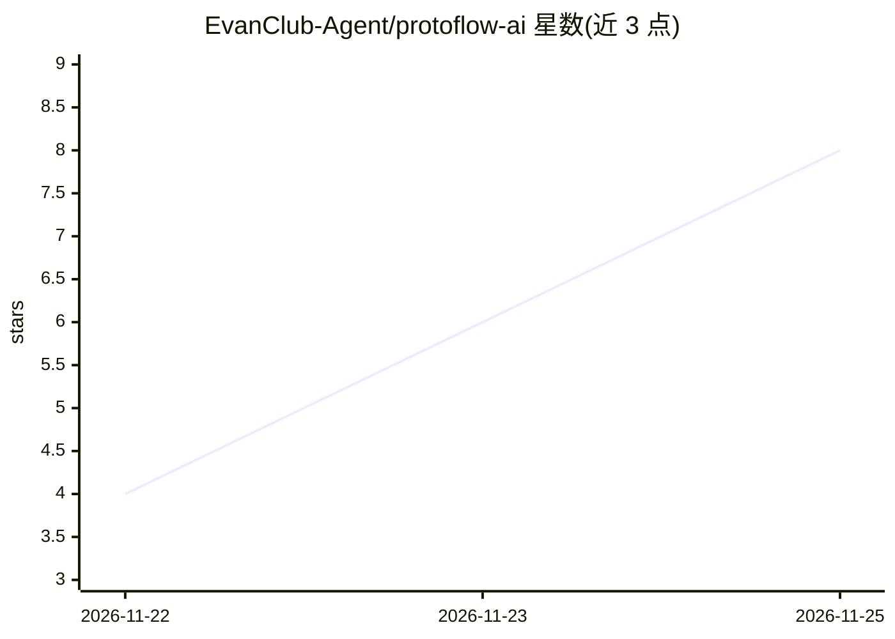

# EvanClub-Agent/protoflow-ai

⭐ 8 · TypeScript · Apache-2.0 · 推送 2026-11-23 · [GitHub](https://github.com/EvanClub-Agent/protoflow-ai) · [官网](https://alex.xclubai.com/) · 组织维护 · 中文 README

**给产品经理与开发团队的 AI 可视化原型设计与 ER 建模桌面工作台**

Electron + React 桌面工作台：用自然语言描述业务后，AI 先澄清需求再生成模块目录、页面与物理表蓝图；画布基于 AST 双向同步，支持 PC 中后台与移动端视口混排、ER 共表联动、12 类 ECharts 图表、需求便签与闭环巡检。工程以 .pflow 保存在本机，免登录离线可用；通过 Docker Compose 可自建团队在线评审服务；内置 MCP 服务可让 Codex/Claude 等读取规格或操控画布。

## 筛选速览

| 维度 | 判定 | 备注 |
|---|---|---|
| AI 角色 | `ai-enhanced` | 去掉 AI 部分产品仍成立 |
| 许可风险 | `permissive` | Apache-2.0 |
| 部署形态 | `desktop` | 安装包/桌面程序 |
| 模型依赖 | local-ok | 支持本地模型 |
| 硬件要求 | — | 无带数字的原话,不猜 |
| 安装摩擦 | `low` | 无编译、无系统依赖或容器化 |
| 成熟度 | — | 结构信号不足 |

## 能力要点

- AI 先澄清需求再规划目录、页面与共享物理表，支持局部增量修改
- AST 双向画布与 TSX DSL 实时无损同步，可拖拽精修
- ER 物理表建模，多页面共表实时读写互通，含外键影响域分析
- 支持导入 Axure RP 9/11 源文件并转换为可编辑工程

## 适用场景

- 把业务需求快速做成可流转的业务原型并在线评审
- 中后台与移动端页面共用一套物理表做跨端协同设计
- 团队私有化部署原型评审服务
- 让 Coding Agent 通过 MCP 读取 ER 表与页面规格编写生产代码

## 场景标签

`代码生成` · 领域:编码与开发

## 证据(README 行号)

> L27: 在真实研发协作中，产品经理与开发团队常常困在两种极端工具之间：要么画**点不动的静态线框图**，要么让 AI 生成**一次性、没法改局部、页面之间数据各编各的孤立网页**。Alex 专为打通从「需求梳理」到「业务闭环验收」而设计：
> L58:  07 · 开箱即用的 AI 引擎管理中心
> L216: - **Q：不配置 AI 模型，或者不部署 Docker 服务端，能用 Alex 吗？**

## 星数曲线

2026-11-22 4 → 2026-11-25 8（+4）

---
*卡片 v1 · prompt 1.4 · 生成 2026-11-22 · 置信度 high · 依据 README sha `81fbb9ca8747` · [字段定义](../../DATASET.md)*
