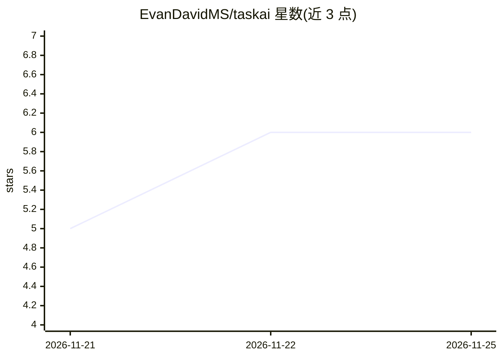

# EvanDavidMS/taskai

⭐ 6 · TypeScript · GPL-3.0 · 推送 2026-11-20 · [GitHub](https://github.com/EvanDavidMS/taskai) · 个人维护

**本地 AI 实时整理笔记的桌面应用，强调隐私**

基于 Tauri 2 + Rust + React 的 Windows/Linux 桌面笔记应用：左侧自由输入，停止书写约 3 秒后由本机运行的 Ollama 模型（Qwen 2.5 系列）在右侧生成整理版本，不改写原文。自动归类到用户自定义文件夹，从文本提取带日期时间的待办并按逾期/今天/本周汇总，提供 Windows 提醒通知、周视图、全文搜索、PDF/Markdown 导出、图片粘贴与 30 天回收站。笔记为普通 .md 文件存于 Documents\TaskAI。需下载 2–9 GB 模型，之后可离线运行；macOS 暂无安装包，需自行编译。

## 筛选速览

| 维度 | 判定 | 备注 |
|---|---|---|
| AI 角色 | `ai-enhanced` | 去掉 AI 部分产品仍成立 |
| 许可风险 | `viral` | GPL-3.0 |
| 部署形态 | `desktop` | 安装包/桌面程序 |
| 模型依赖 | local-ok | 支持本地模型 |
| 硬件要求 | — | 无带数字的原话,不猜 |
| 安装摩擦 | `low` | 无编译、无系统依赖或容器化 |
| 成熟度 | — | 结构信号不足 |

## 能力要点

- 本地 Ollama + Qwen 2.5 模型实时整理笔记，原文与整理版分离存储
- 从笔记提取带真实日期时间的待办，跨笔记汇总为逾期/今天/本周列表
- 自动安装便携版 Ollama 与模型的 6 步首次引导
- 笔记以标准 .md 文件保存，可用 Obsidian 等工具打开

## 适用场景

- 快速记录乱糟糟的想法，让 AI 整理成结构化笔记
- 从随手记中自动汇总每日待办并收到提醒
- 希望笔记数据完全不离开本机的隐私场景
- 管理学校、工作、爱好等多文件夹笔记

## 场景标签

`知识库管理` `推理引擎` `AI 写作` · 领域:内容生成

## 证据(README 行号)

> L5: **Escribe como piensas. La IA lo ordena.**
> L31: - 🔒 **100% privado.** La IA corre en tu computadora con Ollama. Tus notas nunca se suben a internet.
> L97: - **⏻ Encender/apagar la IA** (abajo a la izquierda). Apagarla libera la memoria de tu tarjeta de video.

## 星数曲线

2026-11-21 5 → 2026-11-25 6（+1）

---
*卡片 v1 · prompt 1.4 · 生成 2026-11-21 · 置信度 high · 依据 README sha `f2e2f70a1da0` · [字段定义](../../DATASET.md)*
