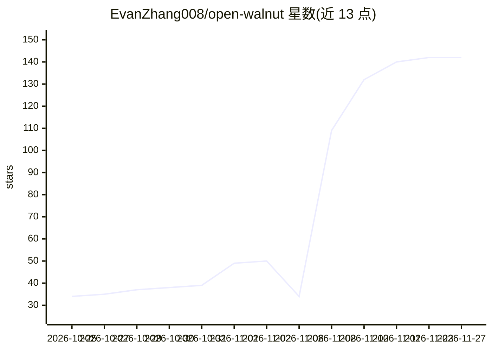

# EvanZhang008/open-walnut

⭐ 142 · TypeScript · MIT · 推送 2026-11-26 · [GitHub](https://github.com/EvanZhang008/open-walnut) · [官网](https://openwalnut.dev) · 个人维护 · 中文 README

**给开发者的自托管网页：在浏览器里运行并管理 Claude Code 会话**

自托管、本地优先的单页 Web 应用，把任务、Markdown 笔记、日历与长期记忆和编码会话放在同一页面。以组织图机制组织 agent：一个 CEO agent 看全部项目，每个项目有 lead 管理自己的 Claude Code 会话与 worker。会话在浏览器断开、SSH 掉线或服务器重启后持续运行，每个会话的改动从自身历史重建 diff 并可回传评审；同时支持 Codex、Gemini、OpenCode、Goose 会话（需先装各自 CLI）与通过 SSH 管理远程开发机。

## 筛选速览

| 维度 | 判定 | 备注 |
|---|---|---|
| AI 角色 | `ai-ecosystem` | LLM/agent 周边工具 |
| 许可风险 | `permissive` | MIT |
| 部署形态 | `library` | 以包/库形式分发 |
| 模型依赖 | locked-api |  |
| 硬件要求 | — | 无带数字的原话,不猜 |
| 安装摩擦 | `low` | 无编译、无系统依赖或容器化 |
| 成熟度 | — | 结构信号不足 |

## 能力要点

- CEO/lead/worker 组织图结构，每个项目一个 lead 管理 Claude Code 会话
- 会话跨浏览器断开、SSH 掉线与服务器重启持续运行（SSH 部署 daemon，无需 tmux）
- 按会话重建 diff、逐行评论并回传同一会话；工作流以实时图展示 subagent 状态
- 本地优先存储于 ~/.open-walnut/，本地嵌入与语音模型（Qwen3-Embedding-0.6B / Qwen3-ASR）

## 适用场景

- 在浏览器里同时运行和监控多个本地与远程 Claude Code 会话
- SSH 掉线后继续跟踪长时间运行的编码任务
- 把任务、笔记和会话改动评审集中在一个自托管页面管理

## 场景标签

`编码 Agent` · 领域:编码与开发

## 证据(README 行号)

> L23: Walnut runs its agents on Claude Code, signed in once.
> L48: - **Claude Code workspace**: Run and monitor multiple Claude Code sessions side by side
> L52: - **Durable sessions**: Sessions keep running across browser disconnects, dropped SSH

## 星数曲线

2026-10-25 34 → 2026-11-27 142（+108）

---
*卡片 v1 · prompt 1.4 · 生成 2026-11-27 · 置信度 high · 依据 README sha `e22a94689bbe` · [字段定义](../../DATASET.md)*
