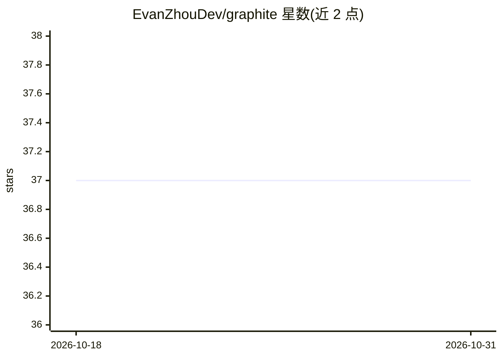

# EvanZhouDev/graphite

⭐ 37 · JavaScript · GPL-3.0 · 推送 2026-04-06 · [GitHub](https://github.com/EvanZhouDev/graphite) · [官网](https://graphite-editor.vercel.app) · 个人维护

**面向写作者的 AI 辅助文本编辑器（Web 应用）**

基于 Next.js 14 / React 18 构建的在线文本编辑器，界面分为 Editor、Chat、Library 三个联动区块：编辑器中写作，Chat 中可就已写内容与 Gemini 1.5 Pro 对话（经 Vercel AI SDK 接入，支持流式与函数调用），Library 中预览与选择文件。采用 Material You 设计语言与 Tailwind 主题。面向写作者与作者，托管于 Vercel，也可用 Bun 在本地克隆源码运行开发服务器。

## 筛选速览

| 维度 | 判定 | 备注 |
|---|---|---|
| AI 角色 | `ai-enhanced` | 去掉 AI 部分产品仍成立 |
| 许可风险 | `viral` | GPL-3.0 |
| 部署形态 | `None` |  |
| 模型依赖 | — | README 未给出锁定关系 |
| 硬件要求 | — | 无带数字的原话,不猜 |
| 安装摩擦 | `low` | 无编译、无系统依赖或容器化 |
| 成熟度 | — | 结构信号不足 |

## 能力要点

- Editor/Chat/Library 三区块联动，Chat 可就编辑器内容提问
- 通过 Vercel AI SDK 接入 Gemini 1.5 Pro，支持流式输出与函数调用
- Material You 设计语言，明暗主题切换
- 提供 Bun 本地开发流程（clone + bun install + bun dev）

## 适用场景

- 在浏览器中写作并随时向 AI 询问已写内容
- 整理和预览多个写作文件
- 本地克隆源码进行二次开发

## 场景标签

`AI 写作` · 领域:内容生成

## 证据(README 行号)

> L3: Try Graphite at graphite-editor.vercel.app | See Graphite in Action on YouTube
> L22:  - Google Gemini 1.5 Pro offers a powerful model with a long context and function calling, perfect for Graphite
> L38: Furthermore, for simplicity, Graphite is split into 3 key sections: The Editor, the Graphite Chat, and the Library.

## 星数曲线

2026-10-18 37 → 2026-10-31 37（+0）

---
*卡片 v1 · prompt 1.4 · 生成 2026-10-25 · 置信度 high · 依据 README sha `dc3cdc19157d` · [字段定义](../../DATASET.md)*
