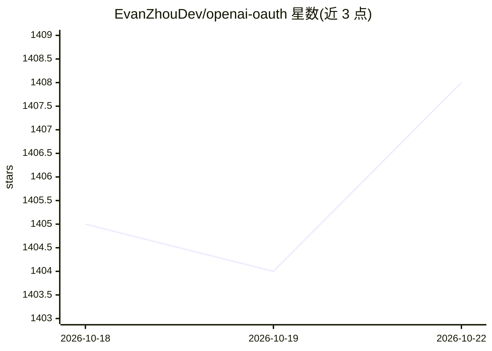

# EvanZhouDev/openai-oauth

⭐ 1,408 · TypeScript · Apache-2.0 · 推送 2026-09-29 · [GitHub](https://github.com/EvanZhouDev/openai-oauth) · [官网](https://openai-oauth.vercel.app) · 个人维护

**把 ChatGPT 账号变成 OpenAI 兼容 API 的 OAuth 接入工具**

面向 TypeScript/Web 开发者的 OAuth 接入层：通过本地 Codex 凭据或‘用 ChatGPT 登录’浏览器扩展获取 OpenAI OAuth 会话，把 ChatGPT 账号转换为本地 OpenAI 兼容端点（默认 localhost:10531，支持 /v1/responses、/v1/chat/completions、流式、工具调用、GPT Image 2 图像生成与编辑），并提供 Vercel AI SDK、OpenAI 客户端适配器及 React 登录组件。凭据本地存储于 ~/.codex，Web 端存 IndexedDB 并用 WebCrypto 加密。图像流式、蒙版等尚不支持。

## 筛选速览

| 维度 | 判定 | 备注 |
|---|---|---|
| AI 角色 | `ai-ecosystem` | LLM/agent 周边工具 |
| 许可风险 | `permissive` | Apache-2.0 |
| 部署形态 | `library` | 以包/库形式分发 |
| 模型依赖 | — | README 未给出锁定关系 |
| 硬件要求 | — | 无带数字的原话,不猜 |
| 安装摩擦 | `low` | 无编译、无系统依赖或容器化 |
| 成熟度 | — | 结构信号不足 |

## 能力要点

- npx openai-oauth 启动 OpenAI 兼容本地代理，无需 API key
- Sign in with ChatGPT React 组件支持用户自带账号（免费/付费计划）
- Credential Sources + Client Adapters 的 SDK 结构，兼容任意 OpenAI-compatible 客户端
- 支持 GPT Image 2 图像生成与编辑（/v1/images 端点）

## 适用场景

- 用自己的 ChatGPT 账号在本地跑 OpenAI 兼容 API，省去 API key
- 在 Next.js 应用中让用户以 ChatGPT 账号登录并自带模型额度
- 把 ChatGPT 凭据接入 Vercel AI SDK 或 OpenAI JS 客户端

## 场景标签

`模型网关` · 领域:Agent 开发

## 证据(README 行号)

> L27: Turn your ChatGPT account into an OpenAI-Compatible API. Learn more
> L203: - **Client Adapters**: Allows you to actually use the Credential Source
> L316: `openai-oauth` also works with any OpenAI-compatible client as long as it takes a custom `baseURL` and `fetch`.

## 星数曲线

2026-10-18 1,405 → 2026-10-22 1,408（+3）

---
*卡片 v1 · prompt 1.4 · 生成 2026-10-21 · 置信度 high · 依据 README sha `6ffa12fd577d` · [字段定义](../../DATASET.md)*
