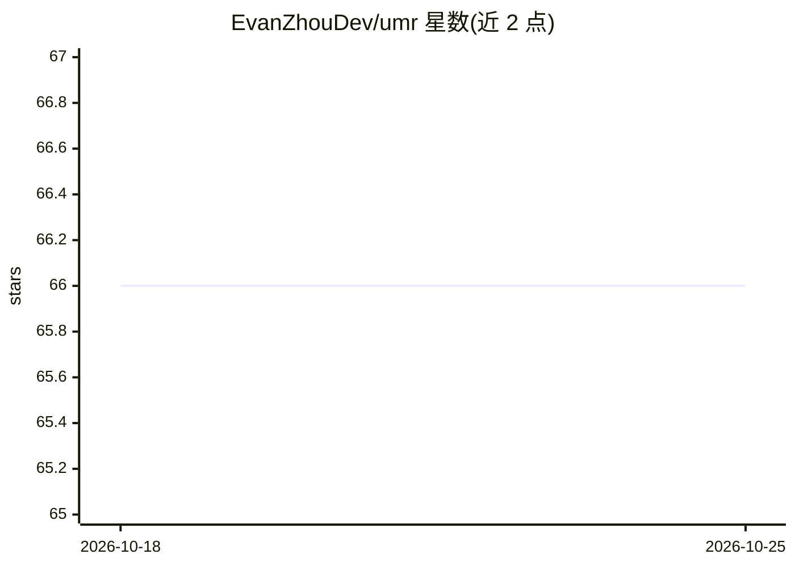

# EvanZhouDev/umr

⭐ 66 · TypeScript · AGPL-3.0 · 推送 2026-04-09 · [GitHub](https://github.com/EvanZhouDev/umr) · [官网](https://www.npmjs.com/package/umr-cli) · 个人维护

**本地 AI 应用的统一模型注册表：一份模型多处共用**

面向本地 AI 应用使用者的模型注册与共享 CLI 工具：维护模型的单一集中副本，通过 `umr link` 以硬链接或指向托管实例的方式将 GGUF 模型接入 LM Studio、Ollama、Jan 等客户端，避免各应用各存一份；也可用 `umr show --path` 输出原始路径供 llama.cpp 等运行时直接使用。模型来源支持 Hugging Face（复用 HF Cache）与本地 GGUF 文件（复制到 ~/.umr 存储）。提供 list/show/unlink/remove/check 命令；移除仅解除跟踪，unlink 后方可 remove。经 npm 全局安装。

## 筛选速览

| 维度 | 判定 | 备注 |
|---|---|---|
| AI 角色 | `ai-ecosystem` | LLM/agent 周边工具 |
| 许可风险 | `viral` | AGPL-3.0 |
| 部署形态 | `library` | 以包/库形式分发 |
| 模型依赖 | local-ok | 支持本地模型 |
| 硬件要求 | — | 无带数字的原话,不猜 |
| 安装摩擦 | `low` | 无编译、无系统依赖或容器化 |
| 成熟度 | — | 结构信号不足 |

## 能力要点

- umr link 将同一模型接入 LM Studio / Ollama / Jan 等客户端，无需重复存储
- 模型来源支持 Hugging Face（复用 HF Cache）与本地 GGUF 文件
- `umr show --path` 输出模型路径供 llama.cpp 等按路径加载的运行时使用
- umr check --fix 自动清理失效链接

## 适用场景

- 本地同时用多个 AI 应用时省去重复下载与存储同一模型
- 统一管理本机所有本地模型的来源、格式与链接状态
- 把已下载的 GGUF 快速接入新装的客户端

## 场景标签

 · 领域:本地 AI 模型管理

## 证据(README 行号)

> L26: UMR is the Unified Model Registry for your local AI apps. It allows you to maintain a single, centralized copy of a
> L89: - **Client**: an app that uses that model, like LM Studio, Ollama, or Jan
> L93: Whenever you add a Model from a Source, you can use that Model across all your Clients, without needing to store an

## 星数曲线

2026-10-18 66 → 2026-10-25 66（+0）

---
*卡片 v1 · prompt 1.4 · 生成 2026-10-24 · 置信度 high · 依据 README sha `cf36d83d8179` · [字段定义](../../DATASET.md)*
