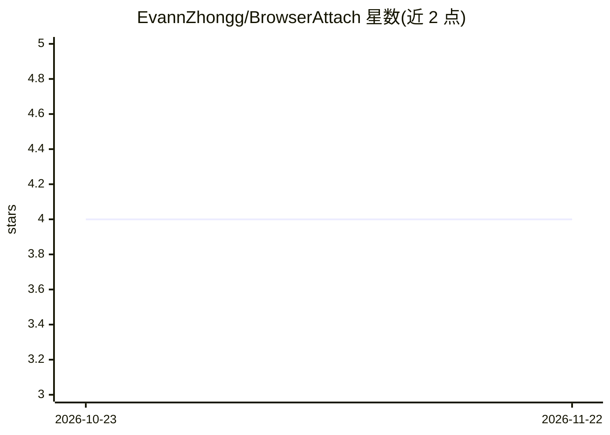

# EvannZhongg/BrowserAttach

⭐ 4 · JavaScript · MIT · 推送 2026-11-21 · [GitHub](https://github.com/EvannZhongg/BrowserAttach) · [官网](https://www.npmjs.com/package/@evan_zhong/browser-attach) · 个人维护 · 中文 README

**MCP server：让客户端控制已登录的 Chrome/Edge 标签页**

BrowserAttach 是一个 stdio MCP server，通过本地配对的浏览器扩展连接用户已打开并已登录的 Chrome/Edge 标签页，无需远程调试端口或独立自动化浏览器。提供 24 个工具：AX 快照、原生点击/输入/悬停/拖拽/滚动、批量步骤、条件等待、导航、对话框处理、文件上传、截图和 JS 求值，并读取 console/network/navigation 日志。Hub 仅监听回环地址，通过随机密钥与扩展配对。需要 Node.js 22+、Chrome/Edge 125+ 和支持 stdio MCP 的客户端。

## 筛选速览

| 维度 | 判定 | 备注 |
|---|---|---|
| AI 角色 | `ai-ecosystem` | LLM/agent 周边工具 |
| 许可风险 | `permissive` | MIT |
| 部署形态 | `library` | 以包/库形式分发 |
| 模型依赖 | — | README 未给出锁定关系 |
| 硬件要求 | — | 无带数字的原话,不猜 |
| 安装摩擦 | `low` | 无编译、无系统依赖或容器化 |
| 成熟度 | — | 结构信号不足 |

## 能力要点

- 通过本地扩展配对控制已登录的浏览器标签页，保留登录状态
- 24 个 stdio MCP 工具，覆盖发现、认领、快照、输入、日志与截图
- 支持 file:// 标签页控制与整页/元素级 PNG 截图
- 批量执行最多 30 步操作，首个失败即停并返回部分结果

## 适用场景

- 让 MCP 客户端/agent 操作已登录的网页应用
- 对本地 file:// 页面做自动化读取与交互
- 在浏览器内读取 console、网络与导航日志做调试观察

## 场景标签

`浏览器自动化` · 领域:效率与自动化

## 证据(README 行号)

> L11: Drive the Chrome / Edge tabs you already have open and already signed in from an MCP client. BrowserAttach connects
> L24: - Standard stdio MCP with 24 tools. The Hub listens on loopback only and pairs with the extension through a random 

## 星数曲线

2026-10-23 4 → 2026-11-22 4（+0）

---
*卡片 v1 · prompt 1.4 · 生成 2026-11-21 · 置信度 high · 依据 README sha `f1796004ab33` · [字段定义](../../DATASET.md)*
