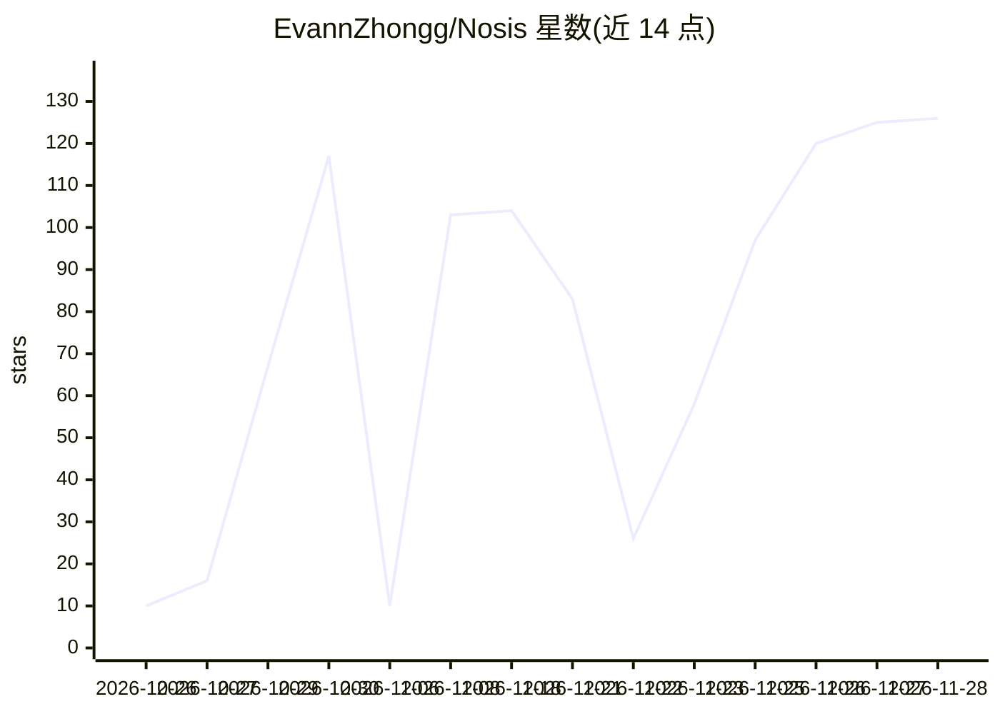

# EvannZhongg/Nosis

⭐ 126 · Python · MIT · 推送 2026-11-25 · [GitHub](https://github.com/EvannZhongg/Nosis) · 个人维护 · 中文 README

**本地优先的个人 agent 运行时：TUI/GUI/飞书三端接入**

开源轻量个人 agent 应用，提供本地工作区操作、人工审批、会话持久化、上下文压缩、长期记忆、计划、子代理、定时任务及 Skill/Plugin/MCP 扩展。架构分 agent_core 与 agent_runtime 两层，前端经 Bridge 进程以换行分隔 JSON 协议驱动运行时，支持 TUI、浏览器 GUI 与飞书三种入口。会话有三种权限预设，shell 按 OS 沙箱执行，桌面操作每次按权限确认。要求 Python≥3.11、Node.js≥22、uv；源码安装需 Rust 工具链，Windows shell 工具需 PowerShell 7。

## 筛选速览

| 维度 | 判定 | 备注 |
|---|---|---|
| AI 角色 | `ai-native` | 本体是模型或模型工具 |
| 许可风险 | `permissive` | MIT |
| 部署形态 | `library` | 以包/库形式分发 |
| 模型依赖 | — | README 未给出锁定关系 |
| 硬件要求 | — | 无带数字的原话,不猜 |
| 安装摩擦 | `medium` | 含编译或系统依赖之一 |
| 成熟度 | — | 结构信号不足 |

## 能力要点

- 三种会话权限预设（Ask for approval / Workspace Access / Full Access）与 OS 沙箱 shell 执行
- 桌面观察与操作工具 computer_screenshot / computer_action，覆盖截图、点击、拖拽、按键、输入
- JSONL 追加日志的可恢复会话、全局与工作区长期记忆、一次性/间隔/cron 定时任务
- 主代理、视觉、图像生成、辅助调用与各子代理角色可独立路由模型

## 适用场景

- 在终端或桌面以对话方式操作本地工作区文件
- 通过飞书远程与 agent 交互并审批其操作
- 配置子代理、技能与 MCP 服务器扩展 agent 能力
- 设置一次性/间隔/cron 定时任务自动执行

## 场景标签

`AI 助手` `Agent 记忆` `GUI 自动化` · 领域:Agent 开发

## 证据(README 行号)

> L7: Nosis is an open-source, lightweight personal agent application. It provides local workspace operations, human appro
> L22: - **Controlled local execution**: A session supports three permission presets — `Ask for approval`, `Workspace Acce
> L28: - **Models and media**: OpenAI-compatible endpoints use the native OpenAI SDK; other routes and image generation us

## 星数曲线

2026-10-26 10 → 2026-11-28 126（+116）

---
*卡片 v1 · prompt 1.4 · 生成 2026-11-28 · 置信度 high · 依据 README sha `0a90e91f65fe` · [字段定义](../../DATASET.md)*
