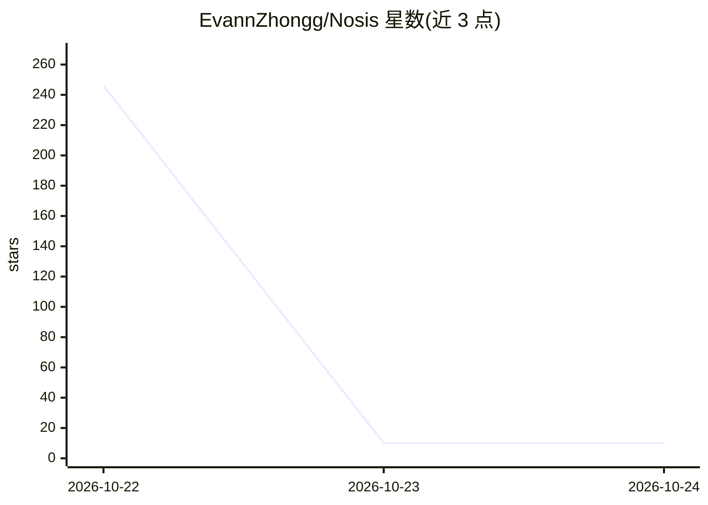

# EvannZhongg/Nosis

⭐ 10 · Python · MIT · 推送 2026-10-23 · [GitHub](https://github.com/EvannZhongg/Nosis) · 个人维护 · 中文 README

**个人本地 AI agent 应用：沙箱执行、桌面操作与长期记忆**

开源轻量级个人 agent 应用，提供 TUI 与 GUI 两种前端，共享同一运行时。核心机制：三级权限预设（询问批准/工作区访问/完全访问）配合工作区沙箱控制本地执行；computer_screenshot/computer_action 实现桌面观察与操作；web_fetch/web_search 支持多检索后端；会话以 JSONL 日志持久化，支持长期记忆、计划、子 agent 与定时任务。模型接入通过 OpenAI 兼容端点与 LiteLLM，可按角色独立路由。需 Python>=3.11、Node.js>=22，从源码安装，Windows 下 shell 工具需另装 PowerShell 7。

## 筛选速览

| 维度 | 判定 | 备注 |
|---|---|---|
| AI 角色 | `ai-native` | 本体是模型或模型工具 |
| 许可风险 | `permissive` | MIT |
| 部署形态 | `library` | 以包/库形式分发 |
| 模型依赖 | — | README 未给出锁定关系 |
| 硬件要求 | — | 无带数字的原话,不猜 |
| 安装摩擦 | `low` | 无编译、无系统依赖或容器化 |
| 成熟度 | — | 结构信号不足 |

## 能力要点

- 三级权限预设与工作区沙箱的本地执行控制
- computer_use 桌面自动化（截图/点击/拖拽/输入）
- TUI 与 GUI 共享同一运行时与会话，JSONL 日志可恢复
- Skill / Plugin / MCP 扩展体系与角色级 provider 路由

## 适用场景

- 在本地终端或图形界面运行可控的个人 AI 助手
- 让 agent 在沙箱内执行 shell 与文件操作并需人工批准
- 搭建带长期记忆与定时任务的自动化工作流

## 场景标签

`AI 助手` `GUI 自动化` `Agent 记忆` · 领域:Agent 开发

## 证据(README 行号)

> L5: Nosis is an open-source, lightweight personal agent application. It provides local workspace operations, human appro
> L20: - **Controlled local execution**: A session supports three permission presets — `Ask for approval`, `Workspace Acce
> L21: - **Desktop automation**: The main agent can observe and operate the visible desktop through `computer_screenshot` 

## 星数曲线

2026-10-22 246 → 2026-10-24 10（-236）

---
*卡片 v1 · prompt 1.4 · 生成 2026-10-22 · 置信度 mid · 依据 README sha `3fec5e360548` · [字段定义](../../DATASET.md)*
