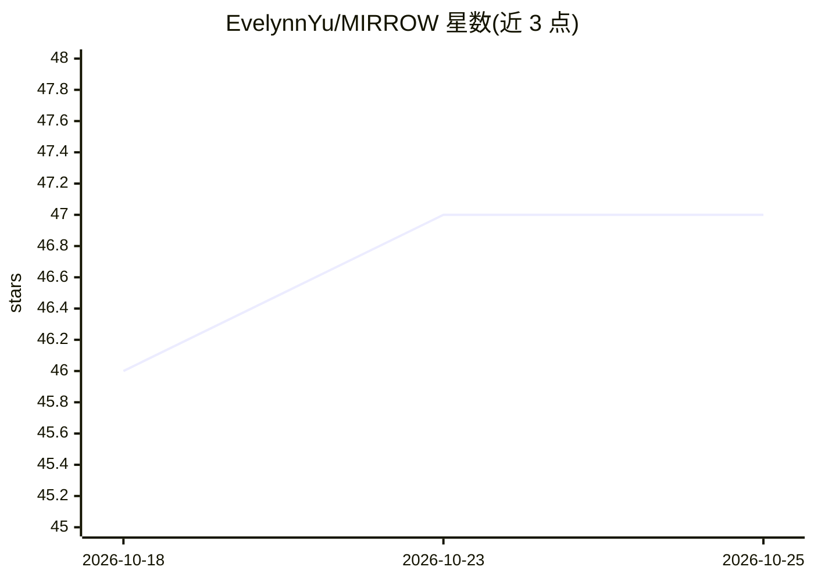

# EvelynnYu/MIRROW

⭐ 47 · Python · MIT · 推送 2026-10-18 · [GitHub](https://github.com/EvelynnYu/MIRROW) · 个人维护 · 中文 README

**单用户本地 AI 伴侣系统：聊天、记忆认知与主动漫想模块**

本地部署的单用户 AI 伴侣系统，提供可复用模块（Memory V2 记忆、三域认知书、漫想运行时、工具调度、感知哨兵、上下文组装等）与一套可启动的 FastAPI 本地前后端，功能覆盖聊天、日结日记、记忆检索、漫想日志与许愿板。LLM 通过回调接入任意 OpenAI 兼容接口，记忆、设备均为可注入可降级设计；私有身份、密钥、账号数据不随仓库提供。参考实现以 Windows 为主，不以云服务或多租户为前提。

## 筛选速览

| 维度 | 判定 | 备注 |
|---|---|---|
| AI 角色 | `ai-native` | 本体是模型或模型工具 |
| 许可风险 | `permissive` | MIT |
| 部署形态 | `library` | 以包/库形式分发 |
| 模型依赖 | — | README 未给出锁定关系 |
| 硬件要求 | — | 无带数字的原话,不猜 |
| 安装摩擦 | `low` | 无编译、无系统依赖或容器化 |
| 成熟度 | — | 结构信号不足 |

## 能力要点

- 模块化架构：感知、意志、行动、记忆四类组件可独立接入自有 FastAPI 宿主
- LLM 无关：所有模块经 call_llm_func 回调消费任意 OpenAI 兼容接口
- Memory V2 提供不可变事件、来源追溯与可修订认知
- 数据源可降级：记忆、设备未注入时对应功能静默跳过，不返回模拟成功

## 适用场景

- 在本地部署一个自己的 AI 伴侣并管理其记忆与日常状态
- 复用记忆认知、漫想调度等模块到自有的 AI 应用宿主
- 让 AI 在本地主动发起活动（漫想模式）并保持打扰判断

## 场景标签

`聊天机器人` `Agent 记忆` · 领域:Agent 开发

## 证据(README 行号)

> L3: MIRROW 是一个单用户、本地部署的 AI 伴侣系统。本仓库提供可复用模块，以及连接聊天、记忆、认知和漫想的独立本地前后端。每位部署者使用自己的身份设定、模型和数据。
> L72: - **LLM 无关**:所有模块通过 `call_llm_func` 类回调消费 LLM,任意 OpenAI 兼容接口均可

## 星数曲线

2026-10-18 46 → 2026-10-25 47（+1）

---
*卡片 v1 · prompt 1.4 · 生成 2026-10-25 · 置信度 high · 依据 README sha `a38ea1697fc0` · [字段定义](../../DATASET.md)*
