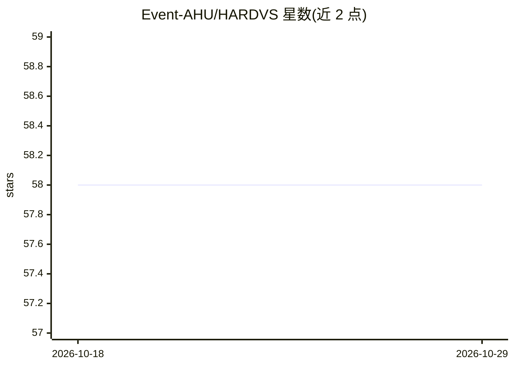

# Event-AHU/HARDVS

⭐ 58 · Python · Apache-2.0 · 推送 2026-06-21 · [GitHub](https://github.com/Event-AHU/HARDVS) · 组织维护 · 中文 README

**事件相机人体活动识别的大规模数据集与基准（300 类、100K+ 序列）**

AAAI-2024 论文配套仓库，提供 HARDVS 大规模事件流人体活动识别数据集（300 类别、超过 100K 事件序列），经百度网盘与 DropBox 分发；同时提出 ESTF 时空特征学习与融合框架：将事件流投影为空间与时间嵌入，用 Transformer 编码并经 FusionFormer 融合后分类。基于 MMAction2 构建训练/测试流程，报告多种主流 HAR 算法的基线结果。面向事件相机与行为识别方向的研究者。

## 筛选速览

| 维度 | 判定 | 备注 |
|---|---|---|
| AI 角色 | `ai-knowledge` | 知识聚合/清单类 |
| 许可风险 | `permissive` | Apache-2.0 |
| 部署形态 | `library` | 以包/库形式分发 |
| 模型依赖 | — | README 未给出锁定关系 |
| 硬件要求 | — | 无带数字的原话,不猜 |
| 安装摩擦 | `low` | 无编译、无系统依赖或容器化 |
| 成熟度 | — | 结构信号不足 |

## 能力要点

- 300 类、超过 100K 事件序列的大规模基准数据集
- ESTF 框架：时空双视角嵌入 + Transformer 融合分类
- 提供多种 HAR 算法的基线评测结果
- 基于 MMAction2 的训练/测试/评测脚本

## 适用场景

- 下载事件相机行为识别数据集开展研究
- 复现或对比 ESTF 框架的基线结果
- 为事件流时空特征学习方法提供评测基准

## 场景标签

`模型评测` · 领域:评测与运维

## 证据(README 行号)

> L12: The main streams of human activity recognition (HAR) algorithms are developed based on RGB cameras which are suffer
> L73: ### Train & Test & Evaluation

## 星数曲线

2026-10-18 58 → 2026-10-29 58（+0）

---
*卡片 v1 · prompt 1.4 · 生成 2026-10-24 · 置信度 high · 依据 README sha `791f3c4711c8` · [字段定义](../../DATASET.md)*
