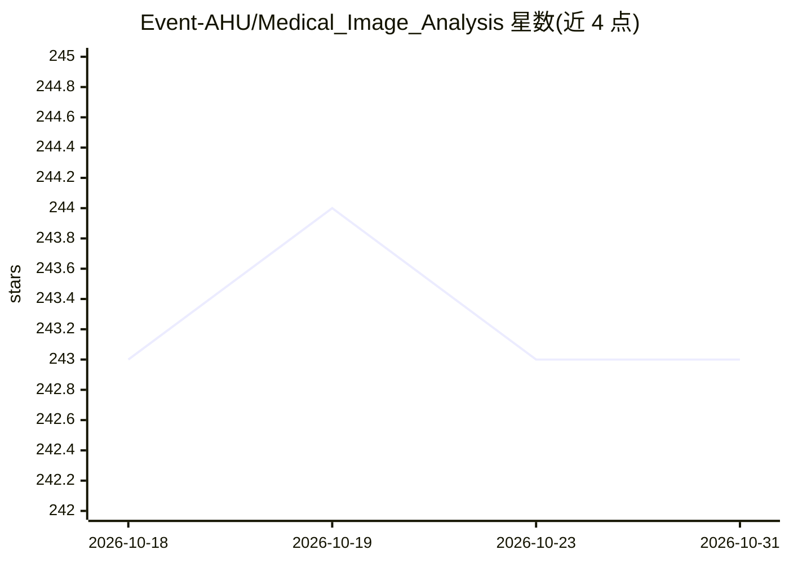

# Event-AHU/Medical_Image_Analysis

⭐ 243 · Python · BSD-3-Clause · 推送 2026-09-22 · [GitHub](https://github.com/Event-AHU/Medical_Image_Analysis) · 组织维护

**医学影像（X光报告生成）研究项目与论文汇集（科研团队主页）**

由 Event-AHU 团队维护的 GitHub 项目主页，汇集其在 X 光医学报告生成方向的系列论文与项目：MambaXray-PRB/CXPMRG-Bench（CheXpert Plus 基准与多阶段预训练框架）、EMRRG（高效微调预训练 Mamba 网络）、R2GenKG（基于 GPT-4o 构建的 M3KG 多模态知识图谱与 LLM 报告生成）、R2GenCSR（上下文样本检索）、MAE 高清 X 光预训练实验等。README 以更新日志、论文列表与摘要为主，部分项目注明源码将发布，面向科研人员跟踪该方向进展。

## 筛选速览

| 维度 | 判定 | 备注 |
|---|---|---|
| AI 角色 | `ai-knowledge` | 知识聚合/清单类 |
| 许可风险 | `permissive` | BSD-3-Clause |
| 部署形态 | `None` |  |
| 模型依赖 | — | README 未给出锁定关系 |
| 硬件要求 | — | 无带数字的原话,不猜 |
| 安装摩擦 | `low` | 无编译、无系统依赖或容器化 |
| 成熟度 | — | 结构信号不足 |

## 能力要点

- 收录 CVPR 2025/TMI/JBHI 等会议期刊的多篇 X 光报告生成论文
- CXPMRG-Bench：CheXpert Plus 数据集上的模型与 LLM 综合基准
- 覆盖 Mamba 视觉骨干、知识图谱、Hopfield 记忆、上下文检索等技术路线
- R2GenKG 含 2477 实体、37424 三元组的多模态医学知识图谱 M3KG

## 适用场景

- 跟踪 X 光放射报告生成的最新模型与基准
- 查找 CheXpert Plus / IU X-ray / MIMIC-CXR 上的对比结果
- 了解 Mamba、知识图谱等技术在医学报告生成中的应用

## 场景标签

`科研工具` `精选清单` · 领域:学习与行业

## 证据(README 行号)

> L25: ## Surveys/Reviews
> L29: ## Projects Maintained in This GitHub:

## 星数曲线

2026-10-18 243 → 2026-10-31 243（+0）

---
*卡片 v1 · prompt 1.4 · 生成 2026-10-22 · 置信度 high · 依据 README sha `09ca30dff60c` · [字段定义](../../DATASET.md)*
