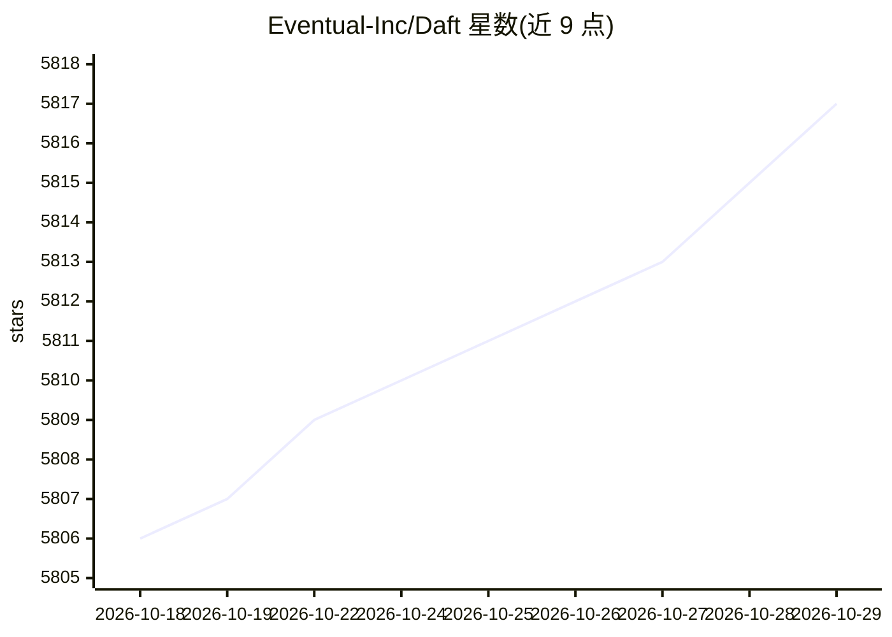

# Eventual-Inc/Daft

⭐ 5,817 · Rust · Apache-2.0 · 推送 2026-10-28 · [GitHub](https://github.com/Eventual-Inc/Daft) · [官网](https://daft.ai) · 组织维护

**面向 AI 与多模态工作负载的高性能分布式数据引擎**

Daft 是 Python 原生、Rust 实现的分布式数据引擎（dataframe），用于处理图像、音频、视频、嵌入向量与结构化数据。内建 AI 操作：可通过 OpenAI、Transformers 或自定义模型运行 LLM 提示、生成嵌入与分类。支持从本地扩展到 Ray、Kubernetes 分布式集群，可连接 S3、GCS、Iceberg、Delta Lake、Hugging Face 等数据源。Apache 2.0 许可，pip 安装，要求 Python 3.10+。README 附与 Pandas/Polars/PySpark 等引擎的功能对比表。

## 筛选速览

| 维度 | 判定 | 备注 |
|---|---|---|
| AI 角色 | `ai-ecosystem` | LLM/agent 周边工具 |
| 许可风险 | `permissive` | Apache-2.0 |
| 部署形态 | `library` | 以包/库形式分发 |
| 模型依赖 | — | README 未给出锁定关系 |
| 硬件要求 | — | 无带数字的原话,不猜 |
| 安装摩擦 | `low` | 无编译、无系统依赖或容器化 |
| 成熟度 | — | 结构信号不足 |

## 能力要点

- 单一框架内原生处理图像/音频/视频/嵌入与结构化数据
- 内建 LLM 提示、嵌入生成与分类操作（OpenAI/Transformers/自定义模型）
- 本地起步可扩展至 Ray、Kubernetes 分布式集群
- 连接 S3、GCS、Iceberg、Delta Lake、Hugging Face 等数据源

## 适用场景

- 在大规模产品图片数据集上批量运行 AI 推理
- 构建处理图像/音频/文本的多模态 ETL 管道
- 在同一框架内混合查询结构化数据与非结构化数据

## 场景标签

 · 领域:数据工程/AI 基础设施

## 证据(README 行号)

> L11: `Daft <https://www.daft.ai>`_ is a high-performance data engine for AI and multimodal workloads. Process images, au
> L14: * **Built-in AI operations:** Run LLM prompts, generate embeddings, and classify data at scale using OpenAI, Transf
> L16: * **Seamless scaling:** Start local, scale to distributed clusters on `Ray <https://docs.daft.ai/en/stable/distribu

## 星数曲线

2026-10-18 5,806 → 2026-10-29 5,817（+11）

---
*卡片 v1 · prompt 1.4 · 生成 2026-10-20 · 置信度 high · 依据 README sha `8ed2a55862ae` · [字段定义](../../DATASET.md)*
