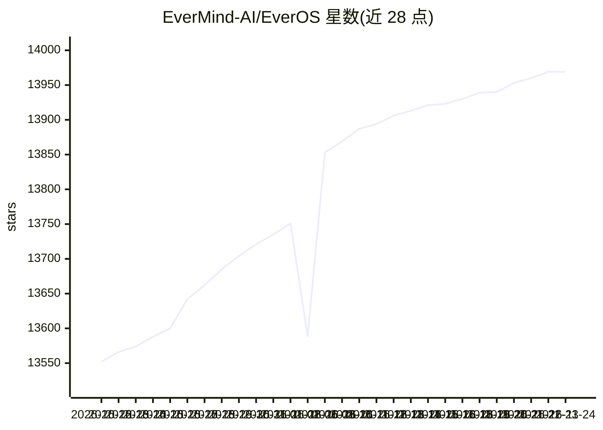

# EverMind-AI/EverOS

⭐ 13,969 · Python · Apache-2.0 · 推送 2026-11-20 · [GitHub](https://github.com/EverMind-AI/EverOS) · [官网](https://evermind.ai/everos) · 组织维护 · 中文 README

**给 AI agent 提供跨应用可携带的本地长期记忆层**

EverOS 是一个 Python 库与本地优先的 agent 记忆运行时：将对话、文件与 agent 轨迹存为可读可编辑的 Markdown，本地 SQLite 与 LanceDB 索引支撑检索，离线反思可在会话间合并记忆、精炼画像与技能。以 OpenRouter 单 key 即可启动，支持分级配置嵌入、重排与多模态解析；提供本地 server 与 /api/v2 HTTP 接口，LibreOffice 为可选的 office 文档解析依赖。

## 筛选速览

| 维度 | 判定 | 备注 |
|---|---|---|
| AI 角色 | `ai-ecosystem` | LLM/agent 周边工具 |
| 许可风险 | `permissive` | Apache-2.0 |
| 部署形态 | `library` | 以包/库形式分发 |
| 模型依赖 | locked-api |  |
| 硬件要求 | — | 无带数字的原话,不猜 |
| 安装摩擦 | `low` | 无编译、无系统依赖或容器化 |
| 成熟度 | — | 结构信号不足 |

## 动量与使用信号

- 维护:`active` — 距上次 push 1.9 天,年发版 19,9 位贡献者
- 涨星:近 1 天 **+18**(自 20261016 起算)
- 安装:pypi 包 `everos` 月下载 20,408
- 平台:— · 协议:MCP

## 能力要点

- Markdown 为事实源，文件可编辑、diff、Git 版本化，级联 watcher 自动同步索引
- 本地三件套 Markdown + SQLite + LanceDB，无需 MongoDB/Elasticsearch/Redis
- 用户侧 episode/profile 与 agent 侧 case/skill 双轨存储，支持多维度正交检索
- 离线反思机制：会话间合并 episode 簇、精炼 profile 与 skill

## 适用场景

- 给编码助手或 agent 接入跨会话长期记忆
- 通过 uvx everos-mcp 将记忆接入 Claude Code、Cursor 等工具
- 摄取图片/PDF/音频等多模态内容入记忆库
- 自建本地 server 供多应用共享同一记忆层

## 场景标签

`Agent 记忆` · 领域:Agent 开发

## 证据(README 行号)

> L16: EverOS is a Python library and local-first memory runtime for agents and
> L73: EverOS adds durable memory to the agent and workflow platforms below—and comes
> L206: The OpenRouter one-key setup is EverOS Tier 1. It supports server startup,

## 星数曲线

2026-10-22 13,552 → 2026-11-24 13,969（+417）

---
*卡片 v1 · prompt 1.4 · 生成 2026-11-22 · 置信度 high · 依据 README sha `b0f13be38ffa` · [字段定义](../../DATASET.md)*
