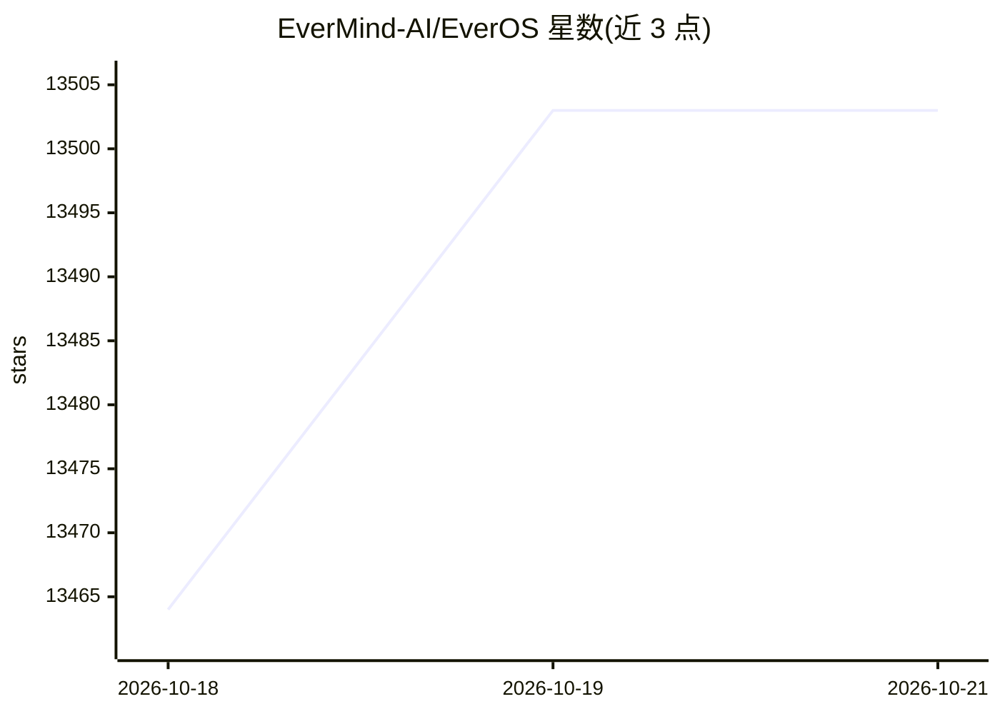

# EverMind-AI/EverOS

⭐ 13,503 · Python · Apache-2.0 · 推送 2026-10-19 · [GitHub](https://github.com/EverMind-AI/EverOS) · [官网](https://evermind.ai/everos) · 组织维护 · 中文 README

**给 AI agent 的本地优先可携带记忆层**

Python 库与本地优先的 agent 记忆运行时：将对话、文件与 agent 轨迹存为可读 Markdown，配合本地 SQLite 与 LanceDB 索引实现检索与离线反思（合并片段、精炼画像与技能）。支持按 user_id/agent_id/app_id/project_id/session_id 正交检索，提供本地服务器与 /api/v2 端点；一个 OpenRouter key 即可运行核心流程，embedding/rerank 为可选配置；Office 文档解析需系统安装 LibreOffice。

## 筛选速览

| 维度 | 判定 | 备注 |
|---|---|---|
| AI 角色 | `ai-native` | 本体是模型或模型工具 |
| 许可风险 | `permissive` | Apache-2.0 |
| 部署形态 | `library` | 以包/库形式分发 |
| 模型依赖 | locked-api |  |
| 硬件要求 | — | 无带数字的原话,不猜 |
| 安装摩擦 | `low` | 无编译、无系统依赖或容器化 |
| 成熟度 | — | 结构信号不足 |

## 动量与使用信号

- 维护:`active` — 距上次 push 1.9 天,年发版 19,9 位贡献者
- 涨星:近 1 天 **+18**(自 20261016 起算)
- 安装:pypi 包 `everos` 月下载 20,408
- 平台:— · 协议:MCP

## 能力要点

- Markdown 为事实源，可用 Git 版本化并直接编辑，级联 watcher 同步索引
- 本地三件套 Markdown+SQLite+LanceDB，无需 MongoDB/Elasticsearch/Redis
- 分层配置：[llm] 基础流程，[embedding]/[rerank]/[multimodal] 逐步解锁混合检索、反思与多模态摄取
- 提供 MCP Server（uvx everos-mcp）接入 Claude Code、Codex、Cursor 等编码助手

## 适用场景

- 为跨应用/跨会话的 AI agent 添加持久长期记忆
- 给 Claude Code/Cursor 等编码助手接入自动保存与召回上下文
- 本地自托管记忆服务，用 Markdown 文件管理与审计 agent 记忆
- 构建需要跨会话自我演进的助手（学习、创意、个人助理等）

## 场景标签

`Agent 记忆` · 领域:Agent 开发

## 证据(README 行号)

> L16: EverOS is a Python library and local-first memory runtime for agents and
> L19: trajectories as readable Markdown, then syncs local SQLite and LanceDB indexes
> L67: > One OpenRouter API key is enough to start EverOS, write durable memories,

## 星数曲线

2026-10-18 13,464 → 2026-10-21 13,503（+39）

---
*卡片 v1 · prompt 1.4 · 生成 2026-10-18 · 置信度 high · 依据 README sha `6cdcccb90bac` · [字段定义](../../DATASET.md)*
