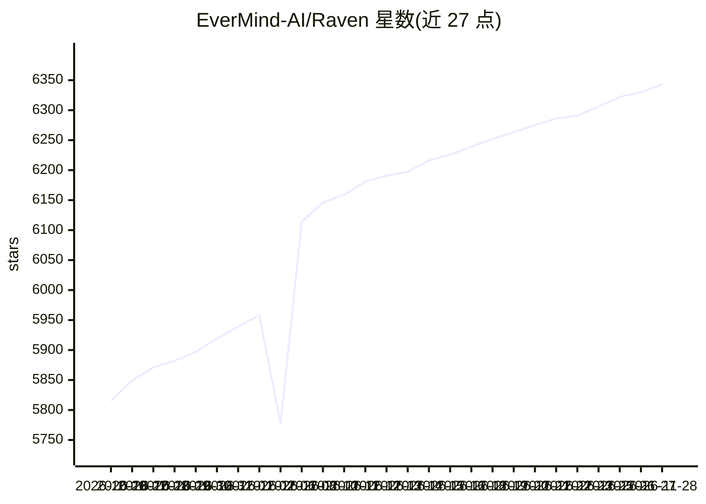

# EverMind-AI/Raven

⭐ 6,343 · Python · Apache-2.0 · 推送 2026-11-27 · [GitHub](https://github.com/EverMind-AI/Raven) · [官网](https://raven.evermind.ai) · 组织维护 · 中文 README

**多智能体编排平台：调度内置与第三方 agent 完成复杂任务**

Raven 以 Host Agent 形式生成 DAG 并编排多个专用 agent，内置 Raven-Research（深度研究与文献综述）、Raven-Code（代码开发与调试）、Raven-Design（幻灯片与视觉设计）、Raven-Oncall（无人值守工作流自动化）四类 agent，通过 EverOS 在会话间携带记忆与上下文。运行时自进化机制将 agent 循环拆分为 Memory/Planning/Capability/Action 四个模块，由实验性的 Curator 工具提出、验证并安装改动。可通过 ACP、CLI 或 OpenAI 兼容 API 接入 16 个第三方 agent 预设。提供 Linux/macOS/WSL2 脚本、Windows PowerShell、Docker Compose 与源码安装途径。

## 筛选速览

| 维度 | 判定 | 备注 |
|---|---|---|
| AI 角色 | `ai-native` | 本体是模型或模型工具 |
| 许可风险 | `permissive` | Apache-2.0 |
| 部署形态 | `self-host` | docker 或自建部署 |
| 模型依赖 | — | README 未给出锁定关系 |
| 硬件要求 | — | 无带数字的原话,不猜 |
| 安装摩擦 | `low` | 无编译、无系统依赖或容器化 |
| 成熟度 | — | 结构信号不足 |

## 能力要点

- 生成 DAG 编排多 agent，内置研究/代码/设计/值守四类 agent
- 运行时自进化：Curator 迭代改写四个策略模块并经验证后安装
- 通过 ACP/CLI/OpenAI 兼容 API 接入 16 个第三方 agent 预设
- 多 agent 轨迹可视化：按时间线展示每步执行

## 适用场景

- 从任务目标到交付物由多 agent 团队自主完成研究、开发与设计
- 无人值守运行实验、优化与持续监控类工作流
- 在统一界面中调度 Claude Code、DeepSeek 等第三方 agent
- 跨会话保留记忆与上下文的持久化助手

## 场景标签

`多智能体` `Agent 框架` `科研工具` `编码 Agent` · 领域:Agent 开发

## 证据(README 行号)

> L23:  One Surface, All Agents: Raven generates DAGs and orchestrates multiple specialized agents for complex tasks.
> L153: Raven can connect to and orchestrate agents via ACP, CLI, or OpenAI-compatible APIs, with presets for 16 **third-p

## 星数曲线

2026-10-26 5,815 → 2026-11-28 6,343（+528）

---
*卡片 v1 · prompt 1.4 · 生成 2026-11-27 · 置信度 high · 依据 README sha `859d4f5c9891` · [字段定义](../../DATASET.md)*
