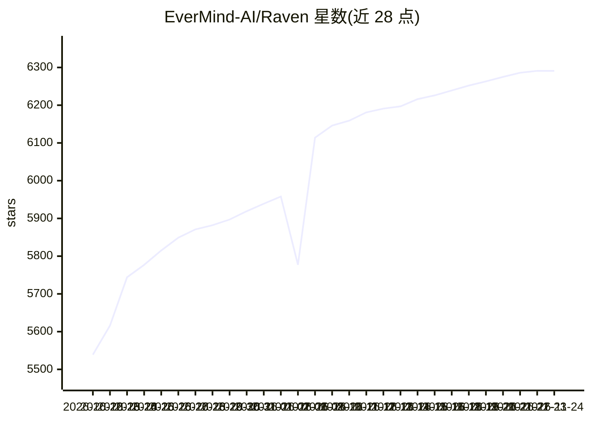

# EverMind-AI/Raven

⭐ 6,306 · Python · Apache-2.0 · 推送 2026-11-23 · [GitHub](https://github.com/EverMind-AI/Raven) · [官网](https://raven.evermind.ai) · 组织维护 · 中文 README

**多智能体编排主机：统筹内置与第三方 agent 协作完成复杂任务**

Raven 定位为多 agent 的统一编排面：通过生成 DAG 将内置的 Research/Code/Design/Oncall 四个 agent 与第三方 agent 组织到同一工作流，按任务委派与协调。内置 ACP、CLI 与 OpenAI 兼容 API 三种接入方式，带 15 个第三方 agent 预设；由 EverOS 提供跨会话的记忆与上下文。运行时自进化部分将 agent 循环拆为 Memory/Planning/Capability/Action 四个策略模块，由实验性的 Curator 工具在验证通过后改写。提供脚本、容器、源码三种安装途径。

## 筛选速览

| 维度 | 判定 | 备注 |
|---|---|---|
| AI 角色 | `ai-ecosystem` | LLM/agent 周边工具 |
| 许可风险 | `permissive` | Apache-2.0 |
| 部署形态 | `self-host` | docker 或自建部署 |
| 模型依赖 | — | README 未给出锁定关系 |
| 硬件要求 | — | 无带数字的原话,不猜 |
| 安装摩擦 | `low` | 无编译、无系统依赖或容器化 |
| 成熟度 | — | 结构信号不足 |

## 能力要点

- 生成 DAG 并编排多个专用 agent 于同一工作流
- 四个内置 agent 覆盖研究、编码、视觉设计、无人值守自动化
- 通过 ACP/CLI/OpenAI 兼容 API 接入第三方 agent，含 15 个预设
- 四模块化 agent 循环与 Curator 实验性自进化工具

## 适用场景

- 把深度研究、编码、设计等任务委派给多个 agent 协作完成
- 用统一界面接入和管理多个第三方 agent
- 无人值守地运行数小时或整夜的实验与监控工作流

## 场景标签

`多智能体` · 领域:Agent 开发

## 证据(README 行号)

> L23:  One Surface, All Agents: Raven generates DAGs and orchestrates multiple specialized agents for complex tasks.
> L153: Raven can connect to and orchestrate agents via ACP, CLI, or OpenAI-compatible APIs, with presets for 15 **third-p
> L25: Raven is **the harness of harnesses, built for recursive self-improvement (RSI).** As a **Host Agent**, it brings b

## 星数曲线

2026-10-22 5,539 → 2026-11-24 6,291（+752）

---
*卡片 v1 · prompt 1.4 · 生成 2026-11-22 · 置信度 mid · 依据 README sha `2a2a2286fe5b` · [字段定义](../../DATASET.md)*
