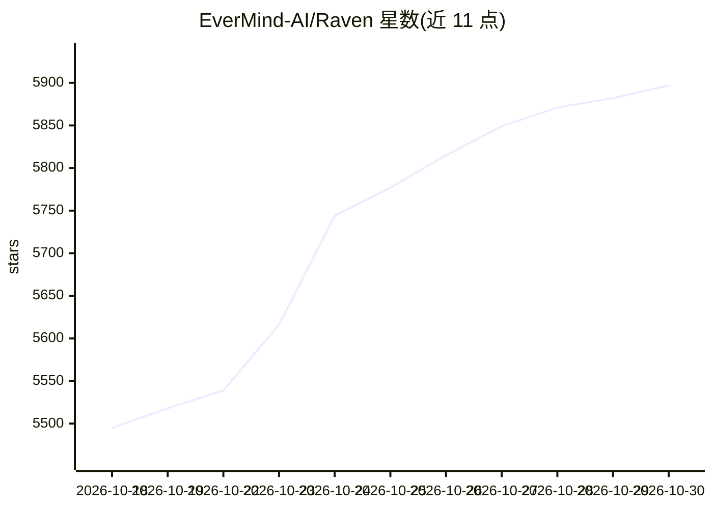

# EverMind-AI/Raven

⭐ 5,897 · Python · Apache-2.0 · 推送 2026-10-29 · [GitHub](https://github.com/EverMind-AI/Raven) · [官网](https://raven.evermind.ai) · 组织维护 · 中文 README

**面向递归自我改进的多智能体编排宿主（Host Agent）**

Raven 是由 EverMind-AI 团队维护的多智能体编排系统：生成 DAG 并调度内置四个专用智能体（Raven-Research 深度研究、Raven-Code 软件开发、Raven-Design 视觉设计、Raven-Oncall 无人值守自动化）及第三方智能体，覆盖研究、编码、设计等任务交付。其架构支持对自身 harness 的迭代改进：Curator 改写 Memory/Planning/Capability/Action 四个策略模块，改动经验证后安装。可经 ACP、CLI 或 OpenAI 兼容 API 接入 13 个第三方智能体。README 声明处于 pre-alpha，接口可能快速变化；Curator 为实验性组件。

## 筛选速览

| 维度 | 判定 | 备注 |
|---|---|---|
| AI 角色 | `ai-ecosystem` | LLM/agent 周边工具 |
| 许可风险 | `permissive` | Apache-2.0 |
| 部署形态 | `self-host` | docker 或自建部署 |
| 模型依赖 | — | README 未给出锁定关系 |
| 硬件要求 | — | 无带数字的原话,不猜 |
| 安装摩擦 | `low` | 无编译、无系统依赖或容器化 |
| 成熟度 | `idea` | |

## 能力要点

- 生成 DAG 并编排内置与第三方多智能体协作
- Curator 运行时改写四个策略模块，实现 harness 自我改进
- 内置 Research/Code/Design/Oncall 四个专用智能体
- 预设接入 13 个第三方智能体（Claude Code、Codex、Hermes Agent 等）

## 适用场景

- 用多智能体协作完成从需求到交付的完整项目
- 接入并统一调度我已有的第三方编码/研究智能体
- 让系统在运行中迭代改进自身的规划与执行策略

## 场景标签

`多智能体` `Agent 框架` · 领域:Agent 开发

## 证据(README 行号)

> L17: Raven is **the harness of harnesses, built for recursive self-improvement (RSI).** As a **Host Agent**, it brings b
> L147: Raven can connect to and orchestrate agents via ACP, CLI, or OpenAI-compatible APIs, with presets for 13 **third-p

## 星数曲线

2026-10-18 5,495 → 2026-10-30 5,897（+402）

---
*卡片 v1 · prompt 1.4 · 生成 2026-10-20 · 置信度 high · 依据 README sha `7938accf8040` · [字段定义](../../DATASET.md)*
