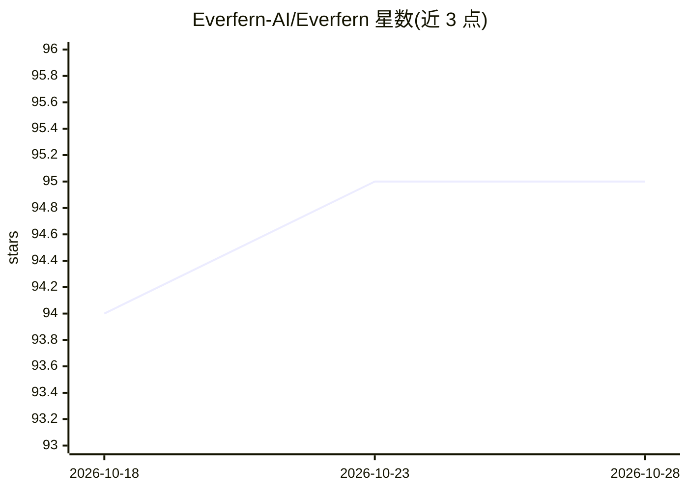

# Everfern-AI/Everfern

⭐ 95 · TypeScript · MIT · 推送 2026-09-22 · [GitHub](https://github.com/Everfern-AI/Everfern) · [官网](https://everfern.app) · 组织维护

**本地运行的桌面 AI agent：用自然语言操控电脑完成各类任务**

开源桌面 AI agent（Electron + Next.js），通过 Computer Use 方式点击、输入、驱动任意桌面应用，并内置浏览器 agent Navis 处理网页任务。支持自研工作流：运行时自生成工具（需人工批准）、可复用技能、失败自动回滚重试、持久记忆与多 agent 讨论。shell 命令在隔离 Linux VM 中执行。模型侧支持 Ollama / LM Studio 完全离线运行，也可接入 OpenAI、Anthropic、DeepSeek 等 10+ 云端提供商。提供 Windows/macOS/Linux 预编译包，也可用 Node.js v18+ 从源码构建。

## 筛选速览

| 维度 | 判定 | 备注 |
|---|---|---|
| AI 角色 | `ai-native` | 本体是模型或模型工具 |
| 许可风险 | `permissive` | MIT |
| 部署形态 | `library` | 以包/库形式分发 |
| 模型依赖 | local-ok | 支持本地模型 |
| 硬件要求 | — | 无带数字的原话,不猜 |
| 安装摩擦 | `low` | 无编译、无系统依赖或容器化 |
| 成熟度 | — | 结构信号不足 |

## 能力要点

- Computer Use 操控任意桌面应用，无需集成
- 内置浏览器 agent Navis，用自然语言驱动网页操作
- 支持 Ollama / LM Studio 完全离线运行，可切换 10+ 提供商
- shell 命令在隔离 Linux VM 沙箱中执行

## 适用场景

- 让 AI 替我整理文件、汇总 PDF、操作各类桌面应用
- 完全离线用本地模型跑自动化任务，数据不出本机
- 用自然语言让浏览器完成填表、检索等网页操作

## 场景标签

`GUI 自动化` `浏览器自动化` `多智能体` · 领域:Agent 开发

## 证据(README 行号)

> L15: EverFern is a desktop AI agent that uses your computer the way you would — clicking buttons, navigating apps, filli
> L54: Run fully offline with **Ollama** or **LM Studio**, or connect to **OpenAI, Anthropic, DeepSeek, Gemini, OpenRouter

## 星数曲线

2026-10-18 94 → 2026-10-28 95（+1）

---
*卡片 v1 · prompt 1.4 · 生成 2026-10-23 · 置信度 high · 依据 README sha `c7d8ce95fc79` · [字段定义](../../DATASET.md)*
