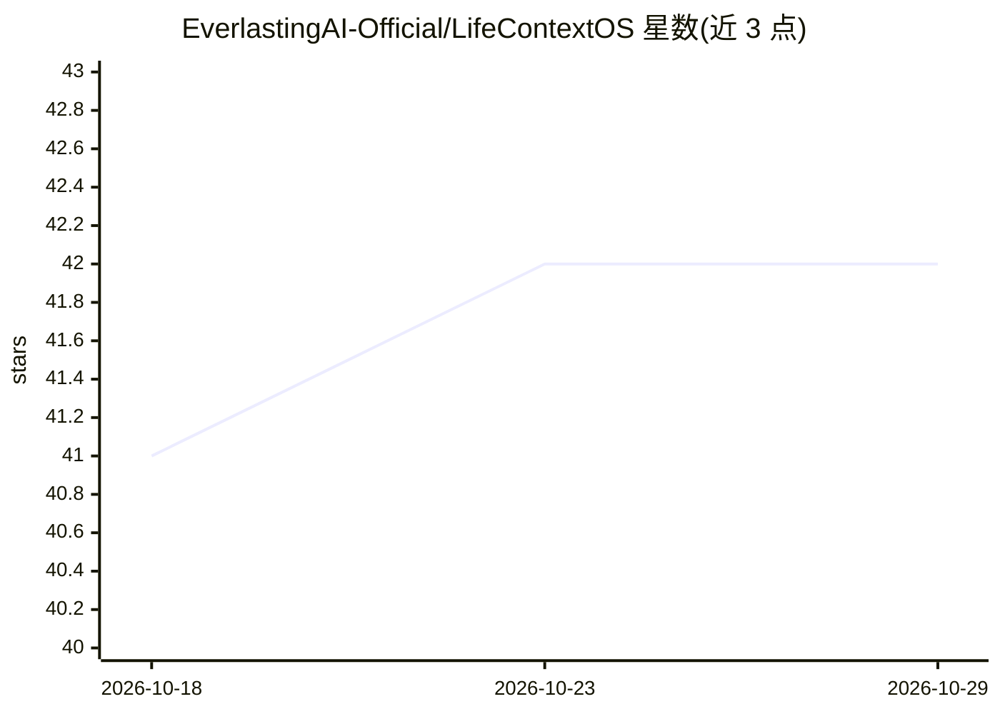

# EverlastingAI-Official/LifeContextOS

⭐ 42 · Python · 推送 2026-09-22 · [GitHub](https://github.com/EverlastingAI-Official/LifeContextOS) · [官网](https://everlasting.zone/) · 组织维护 · 中文 README

**本地优先的人生上下文操作系统，把个人资料编译成可对话的数字自我**

由 Everlasting AI（生生科技）开发的本地优先个人上下文系统，也是拟议 LifeContext 开放规范的首个参考实现。用户授权的聊天记录、文档、口述史经 SourceDocument→Evidence→MemoryRecord 流水线提取，经本人审核后编译为 SOUL/MEMORY/STYLE 人格文件，组装成可对话的 Mindcopy 数字自我。核心链路可全端侧运行（llama.cpp 运行 Qwen3-4B），也支持 OpenAI、DeepSeek、OpenRouter、Anthropic、Gemini 云端模式。处于 Alpha/research prototype 阶段，当前运行环境面向 Windows 10/11。

## 筛选速览

| 维度 | 判定 | 备注 |
|---|---|---|
| AI 角色 | `ai-native` | 本体是模型或模型工具 |
| 许可风险 | `none` | — |
| 部署形态 | `desktop` | 安装包/桌面程序 |
| 模型依赖 | local-ok | 支持本地模型 |
| 硬件要求 | — | 无带数字的原话,不猜 |
| 安装摩擦 | `medium` | 含编译或系统依赖之一 |
| 成熟度 | `idea` | |

## 能力要点

- SourceDocument→Evidence→MemoryRecord→人工审核→人格编译的可追溯数据链
- SOUL/MEMORY/STYLE 人格文件与 Mindcopy 本地对话（llama.cpp 运行 Qwen3-4B GGUF）
- 记忆默认 unreviewed 状态，经本人确认后才用于人格编译
- 拟议 LifeContext 1.0 开放规范与 L1 自动化评测（LongMemEval、M0–M4 对照）

## 适用场景

- 把我的聊天记录和口述史整理成可溯源的个人记忆库
- 用我自己的数据构建可对话的数字自我（Mindcopy）
- 本地运行全链路，个人资料不离开设备
- 导出人生上下文报告（Markdown/PDF）

## 场景标签

`聊天机器人` `Agent 记忆` · 领域:Agent 开发

## 证据(README 行号)

> L19: LifeContext L1 是由 Everlsating AI（生生科技）构建的本地优先个人人生上下文操作系统，也是拟议 **LifeContext 开放规范**的首个参考实现。它把用户主动授权的文档、聊天记录、口述史和声音资料
> L120: |**Mindcopy**|由人格文件、相关证据、会话记忆和运行规则组装出的 L1 数字自我。|
> L142: |本地 Mindcopy 对话|✅|使用 llama.cpp 运行 Qwen3-4B GGUF，支持文本流式输出。|

## 星数曲线

2026-10-18 41 → 2026-10-29 42（+1）

---
*卡片 v1 · prompt 1.4 · 生成 2026-10-25 · 置信度 mid · 依据 README sha `584e854854c9` · [字段定义](../../DATASET.md)*
