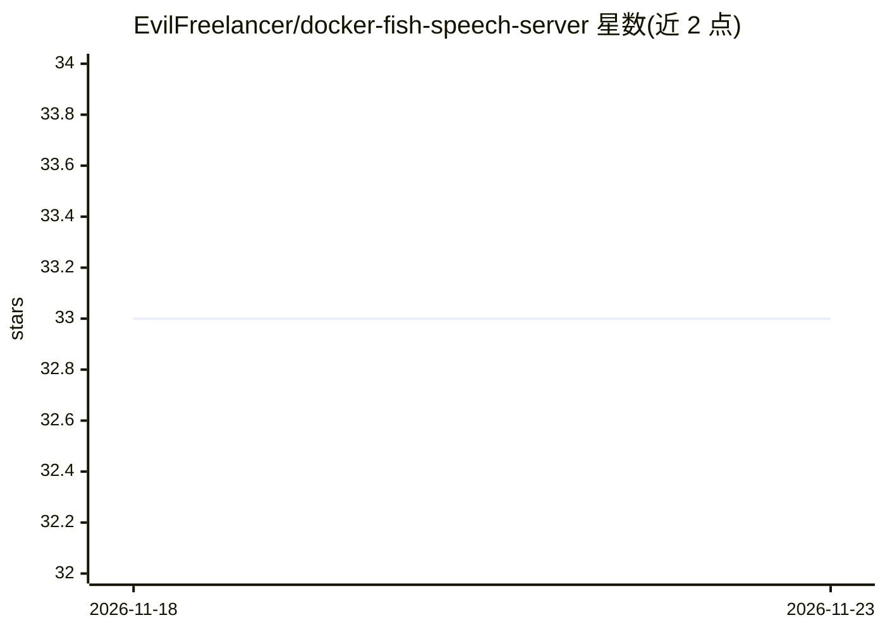

# EvilFreelancer/docker-fish-speech-server

⭐ 33 · Python · MIT · 推送 2026-11-17 · [GitHub](https://github.com/EvilFreelancer/docker-fish-speech-server) · 个人维护

**fish-speech-1.5 语音生成 API 服务器的 Docker 封装**

将 fish-speech-1.5 文本转语音模型封装为 OpenAI 风格 API 服务器的 Docker 项目：提供 /audio/speech（兼容别名 /v1/tts）等端点生成语音，支持通过参考音频做声音风格迁移，可经 /model 端点保存可复用的语音档案（存参考 WAV 与转写文本，不训练新 checkpoint），Docker Compose 将档案持久化在 ./voices。面向需要自托管 TTS API 的开发者，要求 Nvidia GPU，支持 Docker 或 Python 3.12 手动两种部署方式，模型从 Hugging Face 下载。

## 筛选速览

| 维度 | 判定 | 备注 |
|---|---|---|
| AI 角色 | `ai-ecosystem` | LLM/agent 周边工具 |
| 许可风险 | `permissive` | MIT |
| 部署形态 | `self-host` | docker 或自建部署 |
| 模型依赖 | — | README 未给出锁定关系 |
| 硬件要求 | — | 无带数字的原话,不猜 |
| 安装摩擦 | `low` | 无编译、无系统依赖或容器化 |
| 成熟度 | — | 结构信号不足 |

## 能力要点

- 基于 fish-speech-1.5 的 OpenAI 风格 /audio/speech 接口
- 通过参考音频进行语音风格迁移
- /model 端点保存可复用语音档案，Docker 持久化到 ./voices
- Docker Compose 与 Python venv 手动两种部署路径

## 适用场景

- 自托管一个 TTS API 服务器供应用调用
- 用参考音频样本克隆语音风格生成 speech
- 为不同角色保存多个可复用的语音档案

## 场景标签

`语音合成` · 领域:内容生成

## 证据(README 行号)

> L3: OpenAPI-like voice generation server based on fish-speech-1.5.
> L76: curl http://localhost:8000/audio/speech \

## 星数曲线

2026-11-18 33 → 2026-11-23 33（+0）

---
*卡片 v1 · prompt 1.4 · 生成 2026-11-18 · 置信度 mid · 依据 README sha `536c1b27519d` · [字段定义](../../DATASET.md)*
