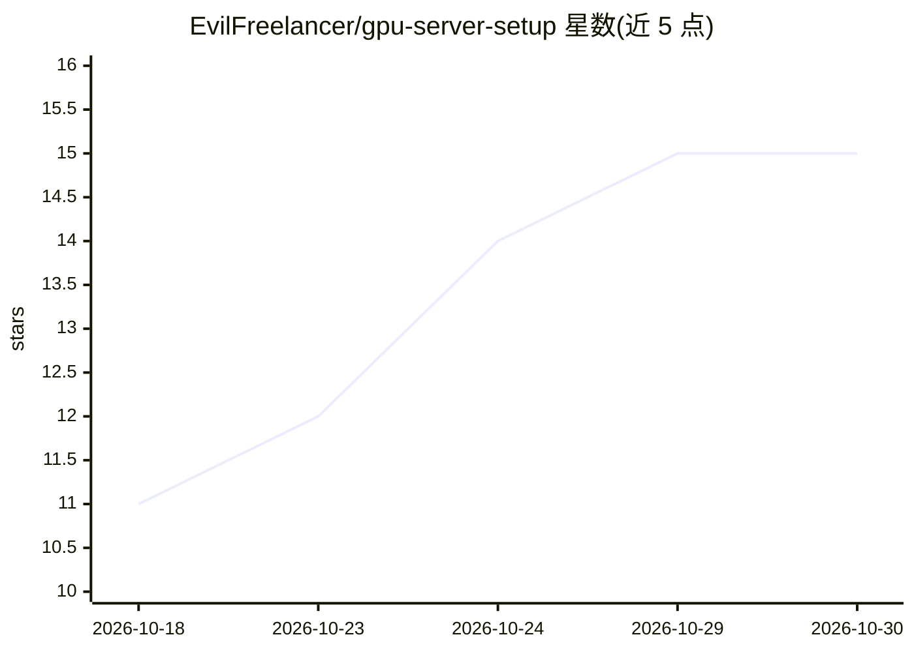

# EvilFreelancer/gpu-server-setup

⭐ 15 · Python · MIT · 推送 2026-10-22 · [GitHub](https://github.com/EvilFreelancer/gpu-server-setup) · [官网](https://github.com/EvilFreelancer/rpa-skills) · 个人维护 · 中文 README

**为 agent 提供的 NVIDIA/Intel GPU Linux 服务器部署技能**

以 SKILL.md 形式分发的 agent 技能：指导将裸 Debian/Ubuntu 服务器配置为 Docker + GPU 推理环境，覆盖 NVIDIA 驱动/CUDA 安装、内核头文件核验、Intel Arc i915/xe 驱动、NVIDIA Container Toolkit、分层验证门（lspci→nvidia-smi→GPU-in-Docker→服务健康）、vLLM/Infinity/OpenWebUI/Ollama 的 compose 预设、GPU 功耗上限与风扇/待机功耗处理。可装入 Claude Code、Cursor、OpenAI Codex 等工具，或作为普通技能目录复制。范围限 Debian 10–13、Ubuntu 20.04–24.04、x86_64，不支持 AMD/ROCm。

## 筛选速览

| 维度 | 判定 | 备注 |
|---|---|---|
| AI 角色 | `ai-knowledge` | 知识聚合/清单类 |
| 许可风险 | `permissive` | MIT |
| 部署形态 | `None` |  |
| 模型依赖 | local-ok | 支持本地模型 |
| 硬件要求 | — | 无带数字的原话,不猜 |
| 安装摩擦 | `medium` | 含编译或系统依赖之一 |
| 成熟度 | — | 结构信号不足 |

## 能力要点

- 分层验证门：任一门失败即停止，scripts/check.sh 自动检测厂商并执行
- vLLM/Infinity/OpenWebUI/Ollama 的 docker-compose 预设（可选叠加层）
- NVIDIA 与 Intel Arc（Alchemist/Battlemage）双路线，含 xe 驱动实测对比
- GPU 功耗上限经 systemd 持久化，Intel Arc 待机 ASPM 降温方案

## 适用场景

- 让 agent 在裸 Ubuntu/Debian 服务器上装好 NVIDIA 驱动、CUDA 与 GPU Docker 环境
- 为 vLLM + OpenWebUI 等推理栈搭好经验证的底层环境
- 排查 GPU 容器不可见、驱动版本不匹配等故障
- 给多卡服务器设功耗上限并配置散热

## 场景标签

 · 领域:GPU 服务器运维/LLM 基础设施

## 证据(README 行号)

> L3: An agent skill that prepares a **Linux server with NVIDIA or Intel Arc GPUs**
> L5: verified Docker + GPU inference stack. It is a portable skill: install it in
> L67: ├─ SKILL.md                 # the skill: workflow, vendor routing, hard rules

## 星数曲线

2026-10-18 11 → 2026-10-30 15（+4）

---
*卡片 v1 · prompt 1.4 · 生成 2026-10-30 · 置信度 high · 依据 README sha `b3b133b5e097` · [字段定义](../../DATASET.md)*
