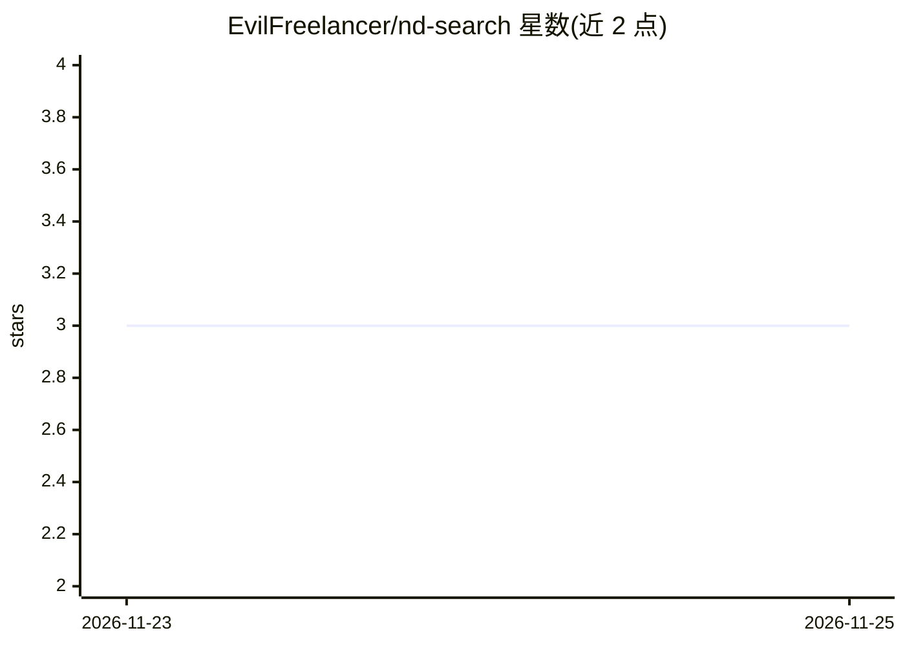

# EvilFreelancer/nd-search

⭐ — · [GitHub]() · 个人维护

**为 AI 编码 Agent 提供网页搜索与站点爬取的技能包**

一个面向 Claude Code、Codex、Cursor、Coddy、Kimi Code CLI 等 Agent 工具的技能（skill）：通过 NeuralDeep Search API 提供网页搜索、按 URL 读取页面纯文本、站点分段爬取和 Telegram 频道搜索四种能力。客户端 scripts/nd_search.py 仅依赖 Python 3.8+ 标准库，每条命令输出紧凑结果并定义 0-6 退出码；SKILL.md 提供搜索-读取-爬取的工作流指令。通过 rpa-skills 插件市场安装，或直接复制为技能文件夹，配额随 NeuralDeep 订阅计划提供（免费计划含搜索配额）。

## 筛选速览

| 维度 | 判定 | 备注 |
|---|---|---|
| AI 角色 | `ai-ecosystem` | LLM/agent 周边工具 |
| 许可风险 | `permissive` | — |
| 部署形态 | `None` |  |
| 模型依赖 | — | README 未给出锁定关系 |
| 硬件要求 | — | 无带数字的原话,不猜 |
| 安装摩擦 | `low` | 无编译、无系统依赖或容器化 |
| 成熟度 | — | 结构信号不足 |

## 能力要点

- web/read/crawl/tg/quota 五个子命令，Python 3.8+ 标准库实现
- 以 SKILL.md 定义 Agent 工作流：先搜索、再读取选中链接、仅爬取整节
- 支持插件市场安装与各工具技能目录的纯文件夹安装
- 结构化退出码区分参数错误、配额耗尽、拒绝访问与网络故障

## 适用场景

- 让编码 Agent 在回答前搜索网页并读取指定 URL 的干净文本
- 爬取某站点的一个完整区段并转成 Markdown 供 RAG 使用
- 检索 Telegram 频道内容
- 查询当前 NeuralDeep 搜索配额余量

## 场景标签

`网页抓取` · 领域:效率与自动化

## 证据(README 行号)

> L44: This skill is distributed through the **rpa-skills** catalog (a Claude Code plugin marketplace), and also installs 
> L19: |`scripts/nd_search.py`|The client: `web`, `read`, `crawl`, `tg`, `quota`. Python 3.8+ standard library only.|

## 星数曲线

2026-11-23 3 → 2026-11-25 3（+0）

---
*卡片 v1 · prompt 1.4 · 生成 2026-11-23 · 置信度 high · 依据 README sha `bf1de27e10ac` · [字段定义](../../DATASET.md)*
