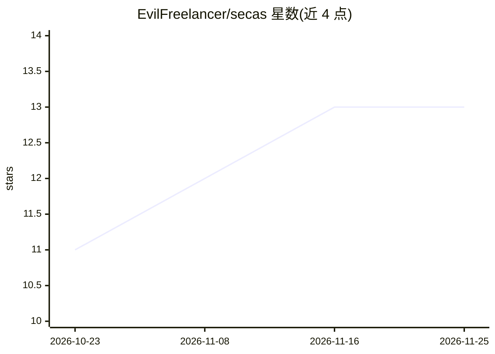

# EvilFreelancer/secas

⭐ 13 · Makefile · Apache-2.0 · 推送 2026-10-13 · [GitHub](https://github.com/EvilFreelancer/secas) · 个人维护

**把 AI 编码代理变成受授权约束的信息安全助手的配置集**

SECAS 是一套自包含配置：以 AGENTS.md 定义代理的行为守则（授权门、范围白名单、每命令人工审批、破坏性操作硬拒绝清单），配套 35 个覆盖侦察、渗透测试、代码与二进制审计、DFIR、检测工程与报告的 Agent Skills，以及一个 make 安装器用于安装安全工具链和启动本地 Metasploitable 3 练习靶机（QEMU、仅回环可访问）。面向安全专业人员，分咨询模式（默认，不接触目标）与执行模式（需授权确认）。

## 筛选速览

| 维度 | 判定 | 备注 |
|---|---|---|
| AI 角色 | `ai-ecosystem` | LLM/agent 周边工具 |
| 许可风险 | `permissive` | Apache-2.0 |
| 部署形态 | `None` |  |
| 模型依赖 | — | README 未给出锁定关系 |
| 硬件要求 | — | 无带数字的原话,不猜 |
| 安装摩擦 | `medium` | 含编译或系统依赖之一 |
| 成熟度 | — | 结构信号不足 |

## 能力要点

- AGENTS.md 策略：授权门、scope 白名单校验、每命令审批、硬拒绝清单
- 35 个按安全生命周期分类的 Agent Skills（ offense/defense/DFIR/检测工程/报告）
- 跨平台 make 安装器适配 apt/dnf/pacman/brew，安装安全 CLI 工具链
- 本地 Metasploitable 3 靶机仅暴露于 127.0.0.1 的沙箱化练习环境

## 适用场景

- 在授权渗透测试中让 AI 代理辅助侦察、利用与提权
- 用 AI 辅助 DFIR：告警分诊、恶意软件与内存镜像分析
- 编写 YARA/Sigma 检测规则与安全报告
- 在本地隔离靶机上练习攻防操作

## 场景标签

`网络安全` · 领域:学习与行业

## 证据(README 行号)

> L3: **SECAS** (SECurity ASsistant) is a self-contained setup that turns an
> L10: 2. **35 curated Agent Skills** that give the agent expert methodology for the
> L23: High-level SECS architecture: an AI coding agent on the developer host (the SECS Harness), governed by the AGENTS.m

## 星数曲线

2026-10-23 11 → 2026-11-25 13（+2）

---
*卡片 v1 · prompt 1.4 · 生成 2026-11-18 · 置信度 high · 依据 README sha `71f00c7473f3` · [字段定义](../../DATASET.md)*
