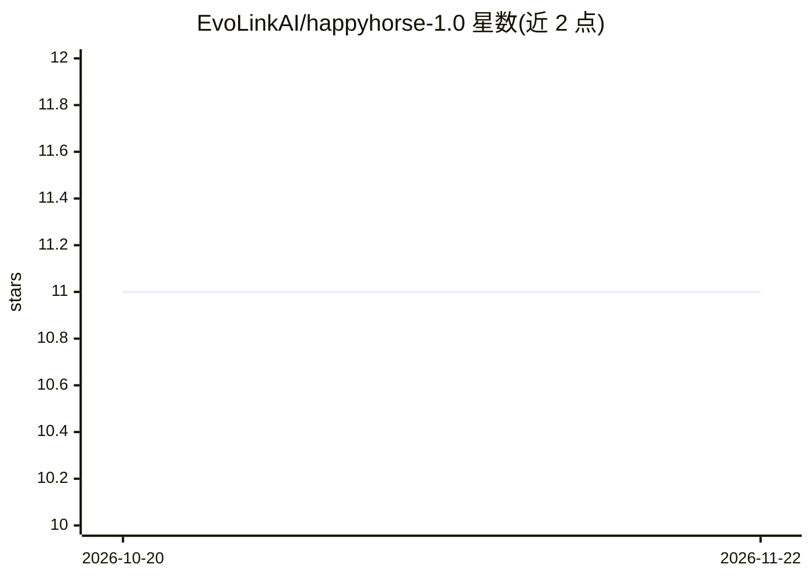

# EvoLinkAI/happyhorse-1.0

⭐ 11 · NOASSERTION · 推送 2026-06-24 · [GitHub](https://github.com/EvoLinkAI/happyhorse-1.0) · [官网](https://evolink.ai/happy-horse) · 组织维护

**追踪 Happy Horse 1.0 视频生成模型的信号、对比与 API 接入指南**

面向 Happy Horse 1.0 视频生成模型的公共信息聚合仓库：汇总 X/Reddit 社区讨论、基准对比数据（benchmarks/models.json）、通过 Evolink 调用 API 的 curl 快速上手示例，以及多模型对比脚本（generate.py/compare.py，Python 3.10+，支持 --dry-run 预估成本）。README 明确声明非官方项目、无确认的开放权重或官网，API key 需从 Evolink 管理页获取，脚本调用第三方 API 可能产生费用。

## 筛选速览

| 维度 | 判定 | 备注 |
|---|---|---|
| AI 角色 | `ai-knowledge` | 知识聚合/清单类 |
| 许可风险 | `none` | NOASSERTION |
| 部署形态 | `library` | 以包/库形式分发 |
| 模型依赖 | — | README 未给出锁定关系 |
| 硬件要求 | — | 无带数字的原话,不猜 |
| 安装摩擦 | `low` | 无编译、无系统依赖或容器化 |
| 成熟度 | — | 结构信号不足 |

## 能力要点

- Text-to-Video / Image-to-Video API 的 curl 快速示例与参数表（分辨率/画幅/时长）
- 多模型基准对比数据文件 benchmarks/models.json
- 可运行的 Python 对比脚本，支持 --dry-run 预估调用成本
- 四类创作工作流的输入规格与提示词结构指南

## 适用场景

- 通过 Evolink API 快速接入 Happy Horse 1.0 生成视频
- 横向对比多个 AI 视频生成模型的参数与价格
- 跟踪该模型在 X/Reddit 上的社区讨论信号

## 场景标签

`视频生成` · 领域:内容生成

## 证据(README 行号)

> L7: Track the latest Happy Horse 1.0 signals in one place — API integration guides, multi-model benchmark comparisons, r
> L203: No. This is a public intelligence hub built from social and community signals.
> L235: This repository is not an official Happy Horse project. It aggregates public discussion from X/Twitter and Reddit 

## 星数曲线

2026-10-20 11 → 2026-11-22 11（+0）

---
*卡片 v1 · prompt 1.4 · 生成 2026-11-19 · 置信度 high · 依据 README sha `2d0223451d75` · [字段定义](../../DATASET.md)*
