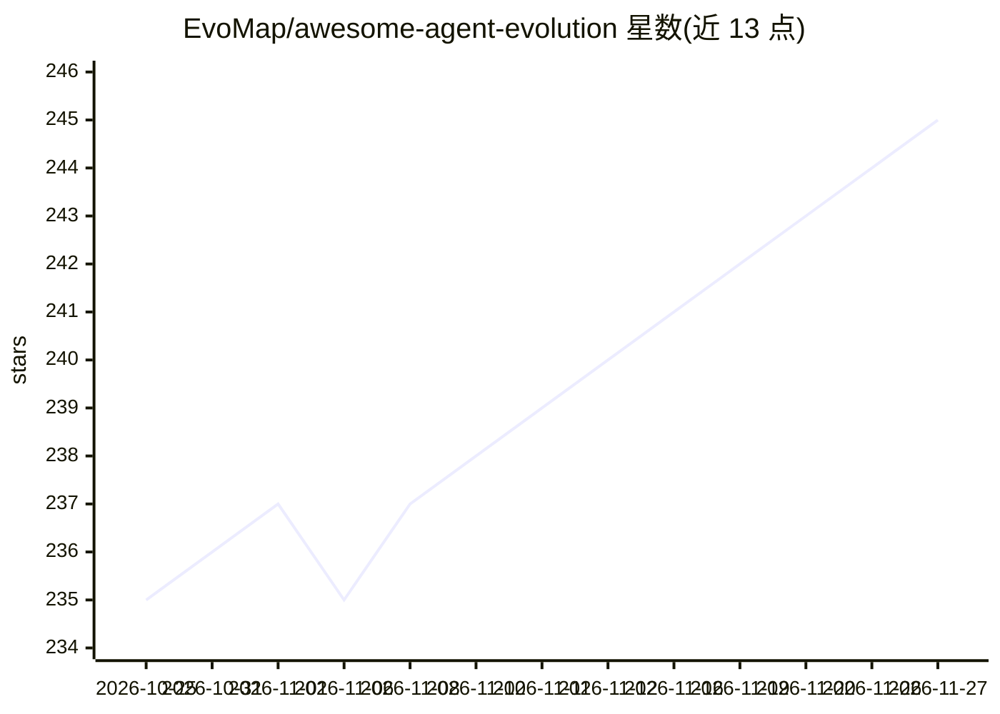

# EvoMap/awesome-agent-evolution

⭐ 245 · JavaScript · NOASSERTION · 推送 2026-11-26 · [GitHub](https://github.com/EvoMap/awesome-agent-evolution) · 组织维护 · 中文 README

**AI Agent 自进化、记忆系统与多智能体架构的项目策展清单**

按分类法组织的 awesome 清单，收录 AI Agent 自进化与自我改进、记忆系统、Agent 间通信协议、Agent 开发平台等类别的开源项目，条目附项目简介、维护者与 star 数。由 evomap.ai 维护，正文为英文，含中文描述条目；清单本身不提供安装与运行说明，仅作项目索引与导航用途。

## 筛选速览

| 维度 | 判定 | 备注 |
|---|---|---|
| AI 角色 | `ai-knowledge` | 知识聚合/清单类 |
| 许可风险 | `none` | NOASSERTION |
| 部署形态 | `library` | 以包/库形式分发 |
| 模型依赖 | — | README 未给出锁定关系 |
| 硬件要求 | — | 无带数字的原话,不猜 |
| 安装摩擦 | `low` | 无编译、无系统依赖或容器化 |
| 成熟度 | — | 结构信号不足 |

## 能力要点

- 按 Single-Agent Optimization、Infrastructure & Protocols 等类别的分类法组织条目
- 覆盖自进化 agent、记忆系统、A2A/MCP 协议、开发平台四个主题
- 每个条目附维护者与 star 数
- 含 mermaid 分类图

## 适用场景

- 为 agent 自进化研究寻找开源项目参考
- 为 agent 应用选型记忆系统组件
- 了解 agent 协议与开发平台的生态现状

## 场景标签

`精选清单` · 领域:学习与行业

## 证据(README 行号)

> L1: # Awesome Agent Evolution Awesome
> L3: > AI Agent self-evolution, memory systems, autonomous self-improvement, and the infrastructure that powers them.
> L5: ## Contents

## 星数曲线

2026-10-25 235 → 2026-11-27 245（+10）

---
*卡片 v1 · prompt 1.4 · 生成 2026-11-27 · 置信度 mid · 依据 README sha `f360a5d50cf0` · [字段定义](../../DATASET.md)*
