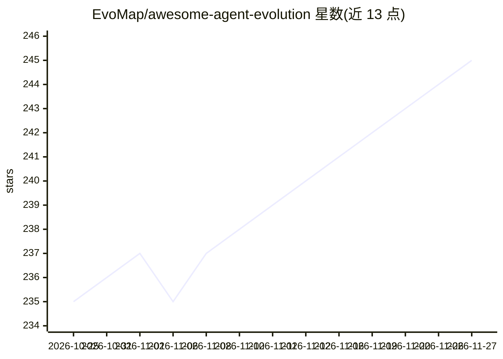

# EvoMap/awesome-agent-evolution

⭐ 245 · JavaScript · NOASSERTION · 推送 2026-11-26 · [GitHub](https://github.com/EvoMap/awesome-agent-evolution) · 组织维护 · 中文 README

**AI Agent 自进化与记忆系统项目的策展清单**

由 EvoMap 维护的 awesome 类型清单，收录 AI Agent 自进化、记忆系统、多智能体协议与开发平台四类开源项目，每条目含一句描述、维护者与 star 数，并用 mermaid 分类图组织目录。覆盖 Agent Evolution and Self-Improvement、Memory Systems、Agent-to-Agent Protocols、Agent Development Platforms 等章节。README 未提供本清单自身的安装或运行方式，仅为链接式目录；部分条目附基准数字（如 LOCOMO）与许可证说明。

## 筛选速览

| 维度 | 判定 | 备注 |
|---|---|---|
| AI 角色 | `ai-knowledge` | 知识聚合/清单类 |
| 许可风险 | `none` | NOASSERTION |
| 部署形态 | `library` | 以包/库形式分发 |
| 模型依赖 | — | README 未给出锁定关系 |
| 硬件要求 | — | 无带数字的原话,不猜 |
| 安装摩擦 | `low` | 无编译、无系统依赖或容器化 |
| 成熟度 | — | 结构信号不足 |

## 能力要点

- mermaid 分类图组织 Single-Agent Optimization / Infrastructure 等类别
- 收录记忆系统条目并附 LOCOMO 等基准数字
- 覆盖 A2A 与 MCP 协议相关项目
- 每条目标注维护者与 star 数

## 适用场景

- 查找 agent 自进化/自我改进方向的开源项目
- 调研 agent 记忆系统的实现与基准
- 了解 agent 间通信协议（A2A/MCP）生态

## 场景标签

`精选清单` · 领域:学习与行业

## 证据(README 行号)

> L1: # Awesome Agent Evolution Awesome
> L3: > AI Agent self-evolution, memory systems, autonomous self-improvement, and the infrastructure that powers them.
> L16: ## Agent Evolution and Self-Improvement

## 星数曲线

2026-10-25 235 → 2026-11-27 245（+10）

---
*卡片 v1 · prompt 1.4 · 生成 2026-11-25 · 置信度 mid · 依据 README sha `95b4eb158b7b` · [字段定义](../../DATASET.md)*
