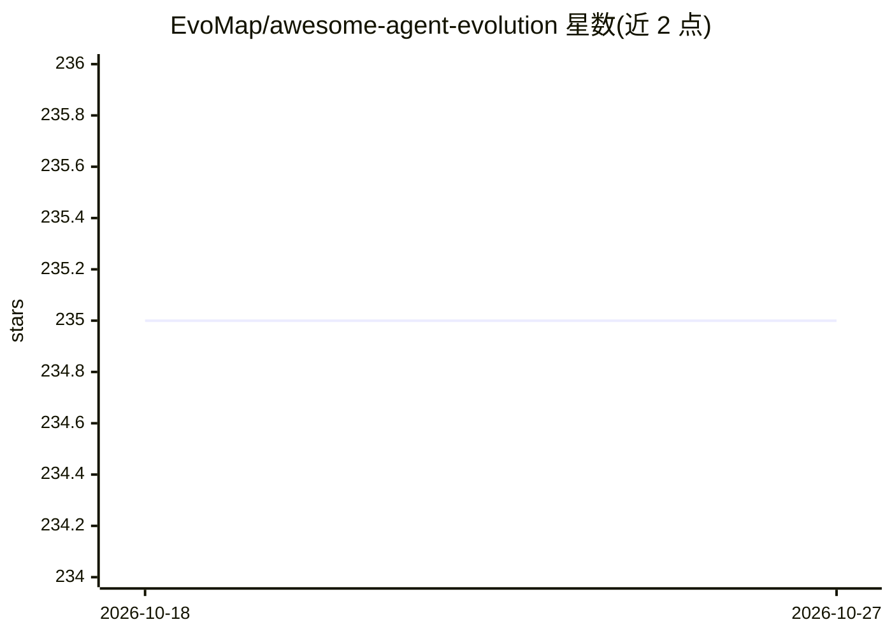

# EvoMap/awesome-agent-evolution

⭐ 235 · JavaScript · NOASSERTION · 推送 2026-10-26 · [GitHub](https://github.com/EvoMap/awesome-agent-evolution) · 组织维护

**AI Agent 自我进化、记忆系统与多智能体架构的策展清单**

由 EvoMap（evomap.ai）维护的 awesome 类策展清单，收录 AI agent 自我进化/自我改进、记忆系统（向量/图/情景记忆等）、Agent 间协议（A2A/MCP）、agent 开发平台四类项目。条目附作者、星数与一句话描述，并以 mermaid 图呈现分类法。清单本身不含代码，不提供安装运行方式，仅作资源导航使用，面向构建 agent 系统的开发者与研究者。

## 筛选速览

| 维度 | 判定 | 备注 |
|---|---|---|
| AI 角色 | `ai-knowledge` | 知识聚合/清单类 |
| 许可风险 | `none` | NOASSERTION |
| 部署形态 | `library` | 以包/库形式分发 |
| 模型依赖 | — | README 未给出锁定关系 |
| 硬件要求 | — | 无带数字的原话,不猜 |
| 安装摩擦 | `low` | 无编译、无系统依赖或容器化 |
| 成熟度 | — | 结构信号不足 |

## 能力要点

- 按自我进化、记忆系统、A2A 协议、开发平台四类组织条目
- 每条含作者、星数与一句话能力描述
- 以 mermaid 图呈现分类体系

## 适用场景

- 查找 agent 记忆系统或自我进化框架的开源项目
- 了解 agent 间协议（A2A/MCP）生态的代表性实现
- 为 agent 开发选型对比平台与框架

## 场景标签

`精选清单` · 领域:学习与行业

## 证据(README 行号)

> L1: # Awesome Agent Evolution Awesome
> L3: > AI Agent self-evolution, memory systems, autonomous self-improvement, and the infrastructure that powers them.
> L7: ## Taxonomy

## 星数曲线

2026-10-18 235 → 2026-10-27 235（+0）

---
*卡片 v1 · prompt 1.4 · 生成 2026-10-22 · 置信度 mid · 依据 README sha `037029071255` · [字段定义](../../DATASET.md)*
