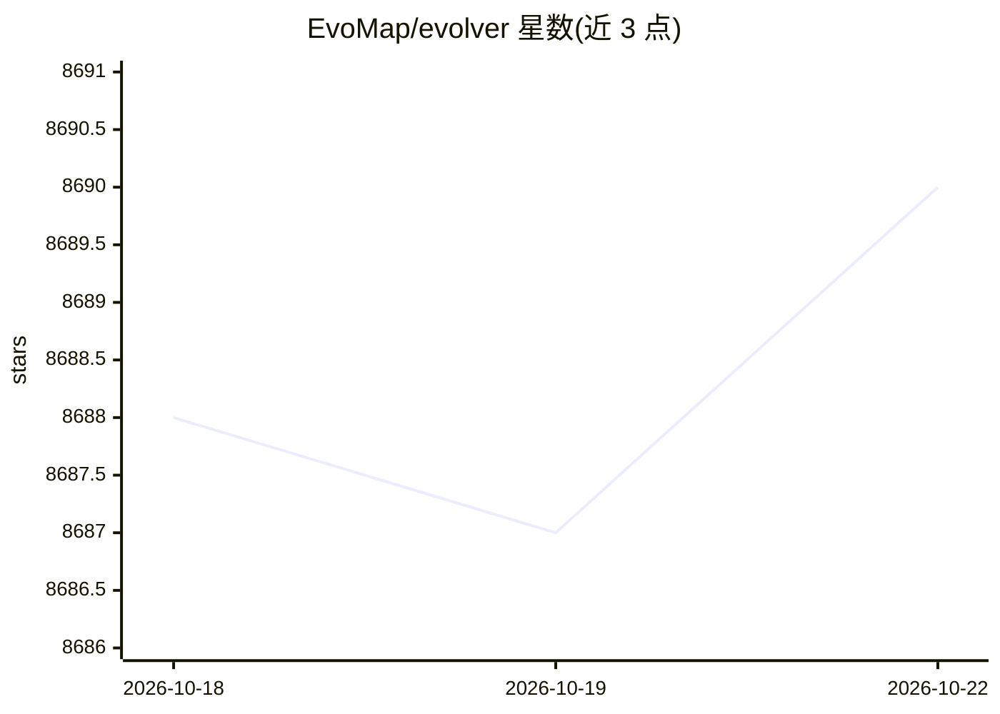

# EvoMap/evolver

⭐ 8,697 · JavaScript · GPL-3.0 · 推送 2026-10-16 · [GitHub](https://github.com/EvoMap/evolver) · [官网](https://evomap.ai) · 组织维护 · 中文 README

**AI agent 自演化引擎：以 GEP 协议生成可审计的演化提示**

基于 GEP 协议的 agent 自演化引擎，面向需要维护大量 agent 提示词与日志的团队。每个演化周期扫描 memory/ 目录的运行日志与错误信号，从内置 Gene/Capsule 资产池选择匹配项，向 stdout 输出协议约束的 GEP 提示词，并写入 EvolutionEvent 供审计。它不自动修改源码、不执行任意 shell 命令、核心功能离线可用。通过 npm 全局安装，以 CLI 在 git 仓库内运行，支持 setup-hooks 接入 Cursor/Claude Code/Codex/Kiro/opencode 等运行时；README 声明未来版本将从完全开源转为 source-available。

## 筛选速览

| 维度 | 判定 | 备注 |
|---|---|---|
| AI 角色 | `ai-ecosystem` | LLM/agent 周边工具 |
| 许可风险 | `viral` | GPL-3.0 |
| 部署形态 | `library` | 以包/库形式分发 |
| 模型依赖 | — | README 未给出锁定关系 |
| 硬件要求 | — | 无带数字的原话,不猜 |
| 安装摩擦 | `low` | 无编译、无系统依赖或容器化 |
| 成熟度 | — | 结构信号不足 |

## 能力要点

- 扫描 memory/ 日志并从本地 GEP 资产池选择 Gene/Capsule 生成提示词
- 写入可审计的 EvolutionEvent，演化由显式 Mutation 对象门控
- setup-hooks 一键接入 Cursor / Claude Code / Codex / Kiro / opencode
- 核心功能离线运行，不自动编辑源码、不执行任意 shell 命令

## 适用场景

- 团队在大规模 agent 提示词与日志上做可追溯的迭代演化
- 把临时的提示词调整变成可复用的 Gene/Capsule 演化资产
- 在多个 agent 运行时（Cursor/Claude Code 等）中挂载演化循环

## 场景标签

`Agent 框架` `提示工程` `Agent 记忆` · 领域:Agent 开发

## 证据(README 行号)

> L36: - **What it is**: A GEP-powered self-evolution engine for AI agents.
> L178: **Evolver is a prompt generator, not a code patcher.** Each evolution cycle:

## 星数曲线

2026-10-18 8,688 → 2026-10-22 8,690（+2）

---
*卡片 v1 · prompt 1.4 · 生成 2026-10-20 · 置信度 high · 依据 README sha `4da9dc935136` · [字段定义](../../DATASET.md)*
