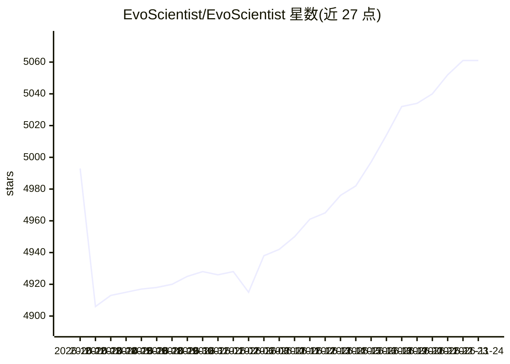

# EvoScientist/EvoScientist

⭐ 5,061 · Python · Apache-2.0 · 推送 2026-11-20 · [GitHub](https://github.com/EvoScientist/EvoScientist) · [官网](https://EvoScientist.ai/) · 组织维护 · 中文 README

**自进化多智能体 AI 科研系统，自动化完整研究流程**

基于 DeepAgents 框架构建的多智能体科研系统，由 6 个子智能体（plan/research/code/debug/analyze/write）协作执行 Intake→plan→execute→evaluate→write→verify 的科研工作流；内置跨会话增长的自进化记忆知识图谱与定期从记忆中提炼可复用技能的 AutoSkills 机制；支持 CLI、WebUI、桌面应用与 Telegram/Slack/飞书/微信等多通道，可按 cron 计划自动运行周期性研究任务。面向希望与 AI 协作开展科研的研究者。

## 筛选速览

| 维度 | 判定 | 备注 |
|---|---|---|
| AI 角色 | `ai-native` | 本体是模型或模型工具 |
| 许可风险 | `permissive` | Apache-2.0 |
| 部署形态 | `desktop` | 安装包/桌面程序 |
| 模型依赖 | locked-api |  |
| 硬件要求 | — | 无带数字的原话,不猜 |
| 安装摩擦 | `low` | 无编译、无系统依赖或容器化 |
| 成熟度 | — | 结构信号不足 |

## 能力要点

- 6 子智能体协作的科研工作流（plan/research/code/debug/analyze/write）
- 自进化记忆：每轮自动蒸馏并自链接为跨会话知识图谱
- AutoSkills 定期将重复模式提炼为可复用技能
- CLI/WebUI/桌面/移动多入口，多通道同一会话

## 适用场景

- 让 AI 智能体自主完成文献调研到论文撰写的科研流程
- 定时自动运行周期性研究任务并汇报结果
- 通过 Telegram/Slack/飞书/微信与同一 agent 会话交互
- 安装科研技能包覆盖端到端研究生命周期

## 场景标签

`多智能体` `科研工具` · 领域:Agent 开发

## 证据(README 行号)

> L21: **EvoScientist aims to harness vibe research by enabling self-evolving AI scientists that autonomously explore, gen
> L71: - **🤖 Multi-Agent Team** — 6 sub-agents (plan, research, code, debug, analyze, write) working in concert.
> L74: - **🌐 Multi-Provider** — Anthropic, OpenAI, Google, MiniMax, NVIDIA — one config to switch.

## 星数曲线

2026-10-22 4,993 → 2026-11-24 5,061（+68）

---
*卡片 v1 · prompt 1.4 · 生成 2026-11-22 · 置信度 mid · 依据 README sha `bd641f5a82f5` · [字段定义](../../DATASET.md)*
