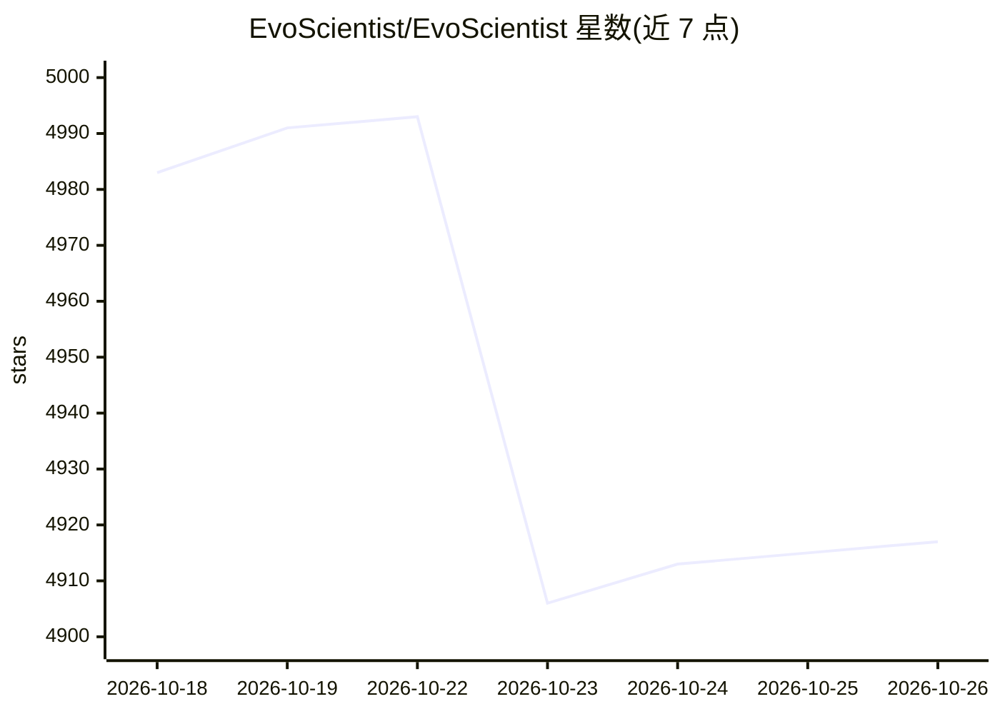

# EvoScientist/EvoScientist

⭐ 4,917 · Python · Apache-2.0 · 推送 2026-10-24 · [GitHub](https://github.com/EvoScientist/EvoScientist) · [官网](https://EvoScientist.ai/) · 组织维护 · 中文 README

**自进化 AI 科学家多智能体系统：自主探索并产出研究成果**

基于 DeepAgents 框架构建的自进化 AI 科研智能体：6 个子智能体（计划、研究、编码、调试、分析、写作）按'接收→规划→执行→评估→撰写→验证'流程协作完成科研任务。具备自动蒸馏的自链接记忆知识图谱、从自身记忆沉淀可复用技能的 AutoSkills、cron 式定时任务与自适应工具选择。支持 Anthropic/OpenAI/Google/MiniMax/NVIDIA 等多提供商一键切换，可通过 CLI、桌面 WebUI、移动端及 Telegram/Slack/飞书/微信等渠道使用。以 PyPI 包及一行安装命令分发。

## 筛选速览

| 维度 | 判定 | 备注 |
|---|---|---|
| AI 角色 | `ai-native` | 本体是模型或模型工具 |
| 许可风险 | `permissive` | Apache-2.0 |
| 部署形态 | `desktop` | 安装包/桌面程序 |
| 模型依赖 | locked-api |  |
| 硬件要求 | — | 无带数字的原话,不猜 |
| 安装摩擦 | `low` | 无编译、无系统依赖或容器化 |
| 成熟度 | — | 结构信号不足 |

## 能力要点

- 6 个子智能体按科学工作流协作（plan/research/code/debug/analyze/write）
- 自进化记忆：每轮自动蒸馏并自链接为跨会话知识图谱
- AutoSkills 从记忆中沉淀可复用技能供人工审查
- 多提供商切换与多渠道接入（CLI/WebUI/移动端/Telegram/Slack/飞书/微信）

## 适用场景

- 让 AI 智能体自主完成从选题到成稿的科研流程
- 通过 Telegram/Slack/飞书等渠道与科研智能体会话
- 用 cron 式定时任务自动执行周期性研究工作

## 场景标签

`多智能体` `科研工具` `Agent 记忆` · 领域:Agent 开发

## 证据(README 行号)

> L21: **EvoScientist aims to harness vibe research by enabling self-evolving AI scientists that autonomously explore, gen
> L71: - **🤖 Multi-Agent Team** — 6 sub-agents (plan, research, code, debug, analyze, write) working in concert.
> L77: - **🔬 Scientific Workflow** — Intake → plan → execute → evaluate → write → verify.

## 星数曲线

2026-10-18 4,983 → 2026-10-26 4,917（-66）

---
*卡片 v1 · prompt 1.4 · 生成 2026-10-20 · 置信度 mid · 依据 README sha `d3556c3c7506` · [字段定义](../../DATASET.md)*
