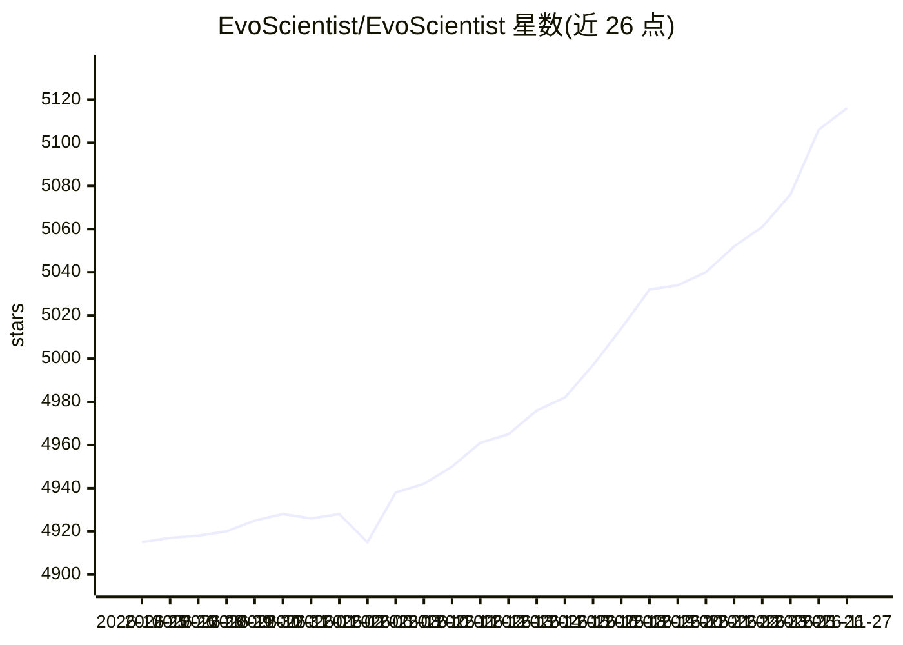

# EvoScientist/EvoScientist

⭐ 5,116 · Python · Apache-2.0 · 推送 2026-11-26 · [GitHub](https://github.com/EvoScientist/EvoScientist) · [官网](https://EvoScientist.ai/) · 组织维护 · 中文 README

**给科研者的自进化多智能体研究助手**

开源的自主研究代理系统：输入研究问题后规划实验、检索文献、编写与调试代码、分析数据并起草报告，通过持久记忆与会话间沉淀的可复用技能实现跨会话改进。内置规划、研究、编码、调试、数据分析与写作等多角色 agent，支持 /goal 与 /rubric 设定验收标准并由独立评分器驱动修订。提供 Desktop、WebUI、TUI、CLI、消息渠道、定时任务与 Python SDK 多种使用形态，基于 LangChain 与 DeepAgents 构建。

## 筛选速览

| 维度 | 判定 | 备注 |
|---|---|---|
| AI 角色 | `ai-ecosystem` | LLM/agent 周边工具 |
| 许可风险 | `permissive` | Apache-2.0 |
| 部署形态 | `desktop` | 安装包/桌面程序 |
| 模型依赖 | local-ok | 支持本地模型 |
| 硬件要求 | — | 无带数字的原话,不猜 |
| 安装摩擦 | `low` | 无编译、无系统依赖或容器化 |
| 成熟度 | — | 结构信号不足 |

## 能力要点

- 多 agent 研究团队：规划、研究、编码、调试、数据分析、写作角色与可安装专家技能
- 自进化记忆与 AutoSkills：自动从会话提炼知识图谱并提议可复用技能
- 支持 MCP 服务器接入与 EvoSkills 工作流安装
- 桌面应用/WebUI/TUI/CLI/消息渠道/定时任务/无头 stream-json 多形态入口

## 适用场景

- 让 AI 代理代为完成文献检索综述与报告起草
- 自动化实验代码编写、调试与数据分析流程
- 按 cron 定时执行周期性研究任务并自动评分
- 通过 Telegram/Slack/飞书等渠道共享代理会话

## 场景标签

`科研工具` `多智能体` `数据分析` · 领域:Agent 开发

## 证据(README 行号)

> L21: **EvoScientist is an open-source, self-evolving AI research buddy.** Give it a research problem and it plans experi
> L70: - **Multi-Agent Research Team:** Built-in planning, research, coding, debugging, data-analysis, and writing special
> L73: - **Every Surface, One Backend:** Desktop app, browser WebUI (`--ui webui`), Textual TUI, classic CLI, messaging ch

## 星数曲线

2026-10-25 4,915 → 2026-11-27 5,116（+201）

---
*卡片 v1 · prompt 1.4 · 生成 2026-11-27 · 置信度 mid · 依据 README sha `c91671397408` · [字段定义](../../DATASET.md)*
