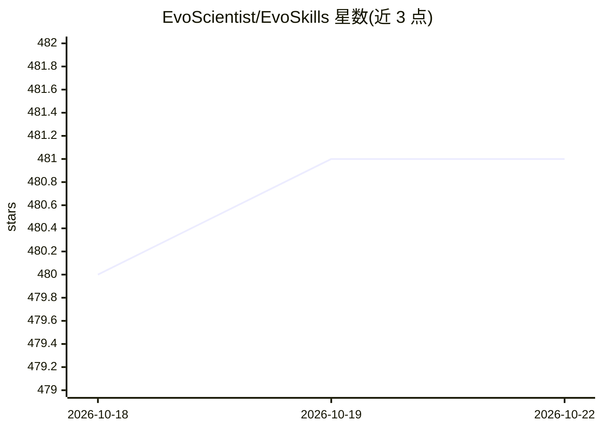

# EvoScientist/EvoSkills

⭐ 481 · Python · Apache-2.0 · 推送 2026-09-30 · [GitHub](https://github.com/EvoScientist/EvoSkills) · [官网](https://evoscientist.ai/#evoskills) · 组织维护 · 中文 README

**EvoScientist 科研 agent 的可安装技能与知识包集合（16+ 个）**

面向 EvoScientist 科研 agent 的官方技能仓库：每个技能是一个可安装的知识包，覆盖研究选题（文献落地与 Elo 锦标赛排序）、实验执行（4 阶段流水线与尝试预算）、论文写作/审稿/答辩、学术幻灯片、持久研究记忆（evo-memory）等环节。通过会话内 /install-skill 命令安装，也声称兼容任意编码 agent（经 skills.sh 支持 Claude Code、Cursor、Codex、Gemini CLI 等）。另收录 MCP 服务器策展目录（arXiv 检索、网页搜索等外部工具）。

## 筛选速览

| 维度 | 判定 | 备注 |
|---|---|---|
| AI 角色 | `ai-knowledge` | 知识聚合/清单类 |
| 许可风险 | `permissive` | Apache-2.0 |
| 部署形态 | `library` | 以包/库形式分发 |
| 模型依赖 | — | README 未给出锁定关系 |
| 硬件要求 | — | 无带数字的原话,不猜 |
| 安装摩擦 | `low` | 无编译、无系统依赖或容器化 |
| 成熟度 | — | 结构信号不足 |

## 能力要点

- 16+ 个自包含科研技能包，可单独或组合使用
- research-ideation 含文献落地、三角色多轨精炼与 Elo 锦标赛排序
- evo-memory 持久研究记忆支撑跨研究周期自我演化
- mcp/ 目录收录 MCP 服务器策展列表（论文检索、网页搜索等）

## 适用场景

- 给 EvoScientist 或其他编码 agent 安装科研全流程技能
- 自动化文献综述、论文规划、写作与答辩准备
- 用 4 阶段实验流水线组织带尝试预算的实验执行

## 场景标签

`科研工具` · 领域:学习与行业

## 证据(README 行号)

> L5: **The official skill repository for EvoScientist. Each skill is an installable knowledge pack that extends EvoScient
> L35: > **Not using EvoScientist?** These skills are compatible with any coding agent.

## 星数曲线

2026-10-18 480 → 2026-10-22 481（+1）

---
*卡片 v1 · prompt 1.4 · 生成 2026-10-21 · 置信度 high · 依据 README sha `b0601b924c73` · [字段定义](../../DATASET.md)*
