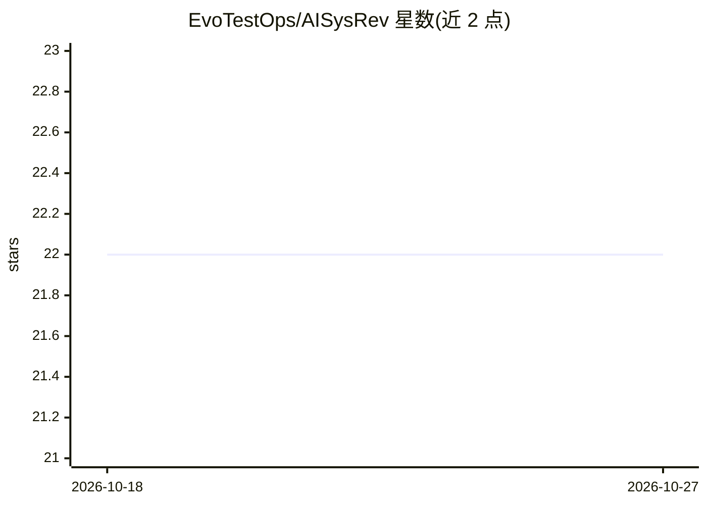

# EvoTestOps/AISysRev

⭐ 22 · Python · MIT · 推送 2026-10-26 · [GitHub](https://github.com/EvoTestOps/AISysRev) · 组织维护

**面向系统综述的 LLM 题录-摘要筛选 Web 应用**

在浏览器中运行、数据存储在本地的系统文献综述辅助工具，支持题录-摘要筛选（Scopus/GitHub CSV 导入）与 PDF 全文筛选。用户设定纳入/排除标准后由多个 LLM 评估论文，输出二元决策、1-7 序数评分或 0-1 纳入概率，可结合人工评估并导出 CSV。LLM 经 OpenRouter、OpenAI 或本地 OpenAI SDK 提供方接入；PDF 全文筛选依赖嵌入检索、需 OpenAI/OpenRouter。通过 Docker Compose 与 make 命令部署。自述为 MVP，部分功能缺失可能存在缺陷。

## 筛选速览

| 维度 | 判定 | 备注 |
|---|---|---|
| AI 角色 | `ai-native` | 本体是模型或模型工具 |
| 许可风险 | `permissive` | MIT |
| 部署形态 | `self-host` | docker 或自建部署 |
| 模型依赖 | local-ok | 支持本地模型 |
| 硬件要求 | — | 无带数字的原话,不猜 |
| 安装摩擦 | `low` | 无编译、无系统依赖或容器化 |
| 成熟度 | `idea` | |

## 能力要点

- 多 LLM 评估题录-摘要，输出二元决策/序数评分/纳入概率
- PDF 全文筛选：按标准检索最相关段落交给 LLM
- 支持 Zotero/EndNote XML 批量挂载 PDF（按 DOI 匹配）
- LLM 调用并行化，OpenRouter 下筛选速度可超 100 篇/分钟

## 适用场景

- 系统综述中用多个 LLM 批量筛选论文题录与摘要
- 结合 LLM 评估与人工判断做全文筛选
- 按纳入/排除标准从 GitHub 项目中筛选软件工具

## 场景标签

`科研工具` · 领域:学习与行业

## 证据(README 行号)

> L15: The AISysRev web-application offers research-backed and AI-based support for Systematic Literature Reviews. Current
> L43: - Evaluate papers against the criteria using multiple LLMs
> L44: - Receive LLM evaluations as binary decisions (include/exclude), ordinal ratings (1-7), or inclusion probabilities 

## 星数曲线

2026-10-18 22 → 2026-10-27 22（+0）

---
*卡片 v1 · prompt 1.4 · 生成 2026-10-27 · 置信度 high · 依据 README sha `521df55b468f` · [字段定义](../../DATASET.md)*
