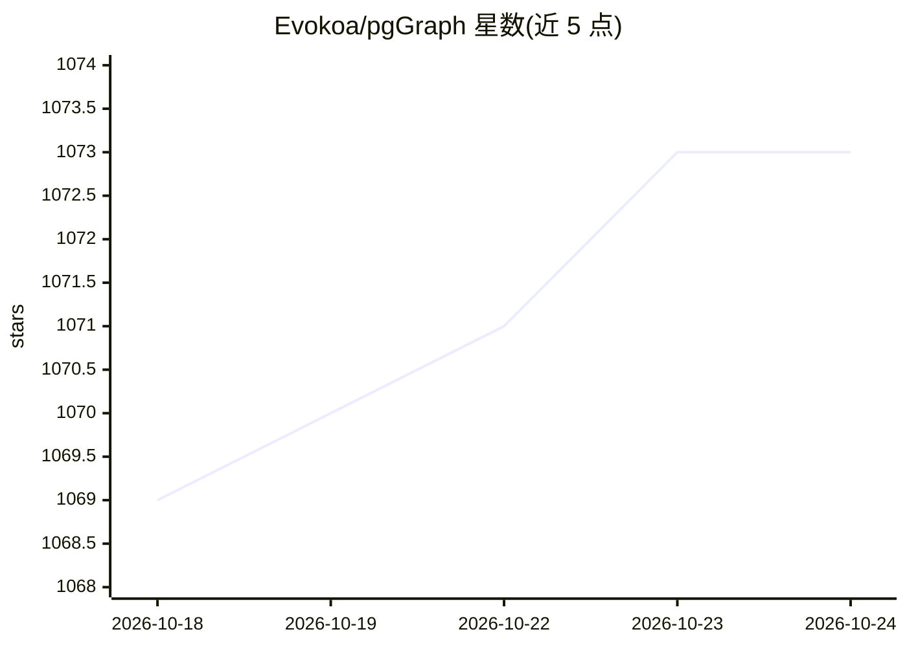

# Evokoa/pgGraph

⭐ 1,073 · Rust · NOASSERTION · 推送 2026-09-23 · [GitHub](https://github.com/Evokoa/pgGraph) · [官网](https://www.polygres.com) · 组织维护

**给已有 PostgreSQL 表加图查询能力的数据库扩展**

pgGraph 是用 Rust/pgrx 编写的 PostgreSQL 扩展（版本 1.2.1，Apache-2.0），在普通关系表之上构建可重建的派生图索引（CSR 前向/反向边存储），通过 graph schema 的 SQL 函数（如 graph.search()、graph.shortest_path()）执行图搜索、遍历、最短路和关系查询，无需单独的图数据库或新查询语言。源表仍为唯一事实来源，PostgreSQL 继续负责存储、WAL、MVCC 与崩溃恢复；图产物为派生状态，可从源表重建。含深度限制、访问节点追踪与内存防护等熔断机制。支持 PostgreSQL 14–18，提供 Docker 镜像、Homebrew tap、PGXN 源码包及 Streamlit playground；另有 polygres.com 托管版（本仓库之外）。

## 筛选速览

| 维度 | 判定 | 备注 |
|---|---|---|
| AI 角色 | `ai-ecosystem` | LLM/agent 周边工具 |
| 许可风险 | `permissive` | NOASSERTION |
| 部署形态 | `self-host` | docker 或自建部署 |
| 模型依赖 | — | README 未给出锁定关系 |
| 硬件要求 | — | 无带数字的原话,不猜 |
| 安装摩擦 | `low` | 无编译、无系统依赖或容器化 |
| 成熟度 | — | 结构信号不足 |

## 能力要点

- 在普通 PostgreSQL 表上构建 CSR 派生图索引，以 SQL 函数执行遍历/最短路/图搜索
- 源表保持唯一事实来源，图产物为可重建的派生状态
- 深度限制、frontier 限制与 OOM 防护等熔断机制
- 支持 PostgreSQL 14–18，提供 Docker / Homebrew / PGXN 多渠道安装

## 适用场景

- 在不迁移数据的前提下对现有关系表做 N 跳关系查询与最短路查找
- 为 GraphRAG 或 agent 应用在 Postgres 上补足图遍历能力
- 替代递归 SQL 处理重复的限定拓扑遍历负载

## 场景标签

 · 领域:数据库/图数据基础设施

## 证据(README 行号)

> L60: pgGraph is a PostgreSQL extension for running graph search, traversal, shortest
> L75: > **Looking for a managed version?** We have launched a managed version of pgGraph on polygres.com for full high pe
> L314: pgGraph does not ask you to move your data or learn Cypher. You keep your

## 星数曲线

2026-10-18 1,069 → 2026-10-24 1,073（+4）

---
*卡片 v1 · prompt 1.4 · 生成 2026-10-21 · 置信度 high · 依据 README sha `547c4eed15b2` · [字段定义](../../DATASET.md)*
