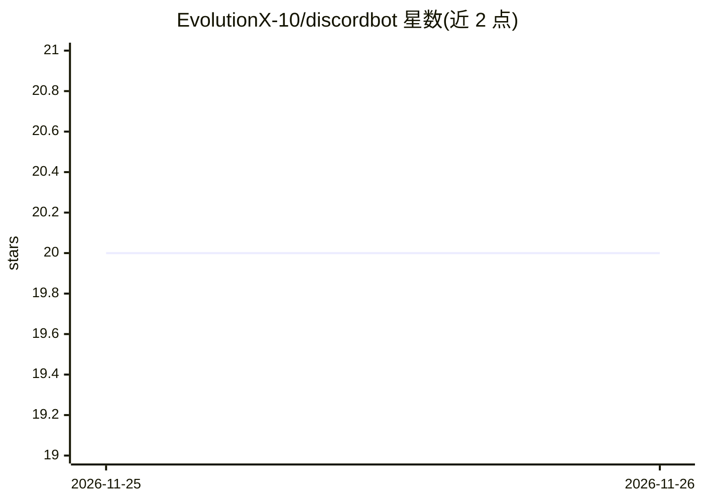

# EvolutionX-10/discordbot

⭐ 20 · TypeScript · MIT · 推送 2026-11-23 · [GitHub](https://github.com/EvolutionX-10/discordbot) · 个人维护

**Bun + discord.js v14 的 TypeScript 机器人起步模板**

基于 Bun 与 discord.js v14 的 Discord 机器人起步模板，内置斜杠命令、上下文菜单、遗留消息命令与自动注册，提供 Command/Listener 类型化包装器、Paginator、Prompt、Resolver 与 Logger 等结构，附多阶段 Dockerfile 部署。面向想自建机器人的人与编程代理：AGENTS.md 约定自动化贡献流程，README 给出手动与代理两种定制路径及多个示例任务。无需任何 AI 提供商或 API key；Bun 直接运行 TypeScript 源码，无编译步骤。

## 筛选速览

| 维度 | 判定 | 备注 |
|---|---|---|
| AI 角色 | `ai-enhanced` | 去掉 AI 部分产品仍成立 |
| 许可风险 | `permissive` | MIT |
| 部署形态 | `self-host` | docker 或自建部署 |
| 模型依赖 | — | README 未给出锁定关系 |
| 硬件要求 | — | 无带数字的原话,不猜 |
| 安装摩擦 | `low` | 无编译、无系统依赖或容器化 |
| 成熟度 | — | 结构信号不足 |

## 能力要点

- Command/Listener 类型化包装器，命令自动注册（shortcut/register/sync 三种模式）
- Bun 直接运行 TypeScript 源码，无编译步骤
- 内置多阶段 Docker 构建用于生产部署
- 附 AGENTS.md 约定，支持编程代理按同一源码与检查流程开发

## 适用场景

- 作为模板快速搭建自己的 Discord 机器人
- 用编程代理按 AGENTS.md 自动添加命令与监听器
- 用 Docker 部署运行 Discord 机器人

## 场景标签

 · 领域:聊天机器人/开发模板

## 证据(README 行号)

> L1: # Discord bot starter for humans and coding agents
> L9: examples, and checks as people. No AI provider or API key is required.
> L49:  Bun runs the TypeScript source directly; there is no compilation step.

## 星数曲线

2026-11-25 20 → 2026-11-26 20（+0）

---
*卡片 v1 · prompt 1.4 · 生成 2026-11-24 · 置信度 high · 依据 README sha `1ef714004c08` · [字段定义](../../DATASET.md)*
