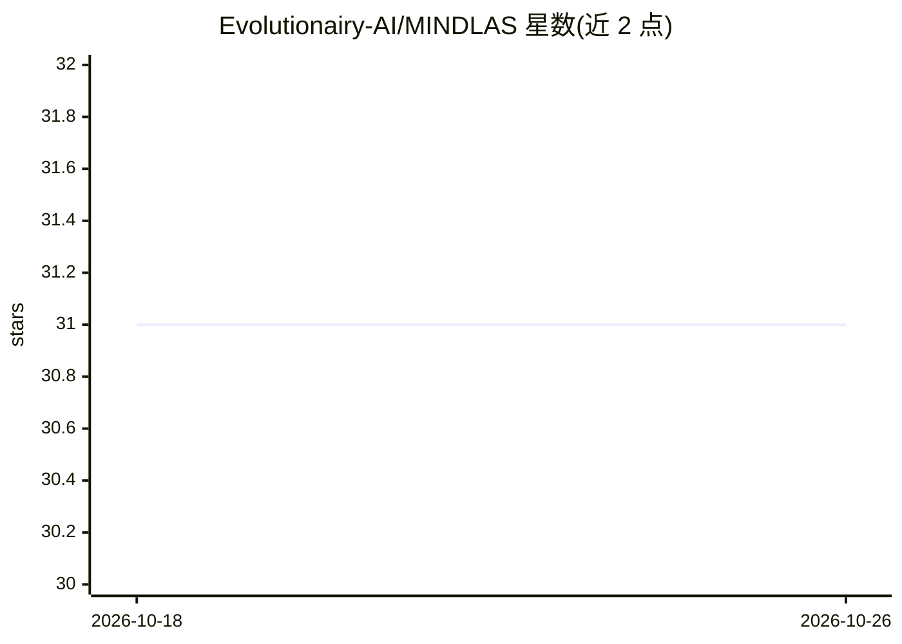

# Evolutionairy-AI/MINDLAS

⭐ 31 · Python · NOASSERTION · 推送 2026-09-30 · [GitHub](https://github.com/Evolutionairy-AI/MINDLAS) · [官网](https://evolutionairy.ai/) · 组织维护

**监控 Claude Code 会话退化的本地仪表与纠正工具**

面向使用 Claude Code 的开发者：通过 8 个 hooks 记录会话事件账本，在状态行实时显示四个仪表（Context Rot、Verification Debt、Change Blast Radius、Tool Failure Loop），在 WATCH/WARNING/ALERT 阈值触发时给出配对的纠正操作（修复上下文包、验证门、补丁拆分、循环停止）。评分为账本的纯函数，评分路径无模型与网络调用；纠正为确定性机制并记录前后对比，可导出 scorecard。本地运行，数据不出机器。声明不保证正确性、不替代测试与人工审查。

## 筛选速览

| 维度 | 判定 | 备注 |
|---|---|---|
| AI 角色 | `ai-ecosystem` | LLM/agent 周边工具 |
| 许可风险 | `none` | NOASSERTION |
| 部署形态 | `library` | 以包/库形式分发 |
| 模型依赖 | — | README 未给出锁定关系 |
| 硬件要求 | — | 无带数字的原话,不猜 |
| 安装摩擦 | `low` | 无编译、无系统依赖或容器化 |
| 成熟度 | — | 结构信号不足 |

## 能力要点

- 四个仪表对应四类已知退化原因，各配一个纠正操作
- 评分为事件账本的纯函数，评分路径无模型、无网络调用
- 8 个 hooks + 状态行 + 5 个 slash 命令接入 Claude Code
- 纠正均记录 before/after 效果并导出 scorecard（终端/JSON）

## 适用场景

- 长会话中及时发现上下文退化并执行 Context Repair
- 阻止 agent 对未验证代码改动声称完成
- 检测同一工具调用的盲目重试循环并施加停止边界
- 导出会话评分卡用于可靠性证据留存

## 场景标签

`LLM 可观测性` · 领域:评测与运维

## 证据(README 行号)

> L16: Mindlas catches that moment live: deterministic gauges under your Claude Code prompt that read the session's own si
> L24: Scores are pure functions of the session's event ledger. Same ledger in, same score out. There is no model and no n
> L30: Requirements: Python >= 3.11, git, Claude Code.

## 星数曲线

2026-10-18 31 → 2026-10-26 31（+0）

---
*卡片 v1 · prompt 1.4 · 生成 2026-10-26 · 置信度 high · 依据 README sha `08c9b54312ee` · [字段定义](../../DATASET.md)*
