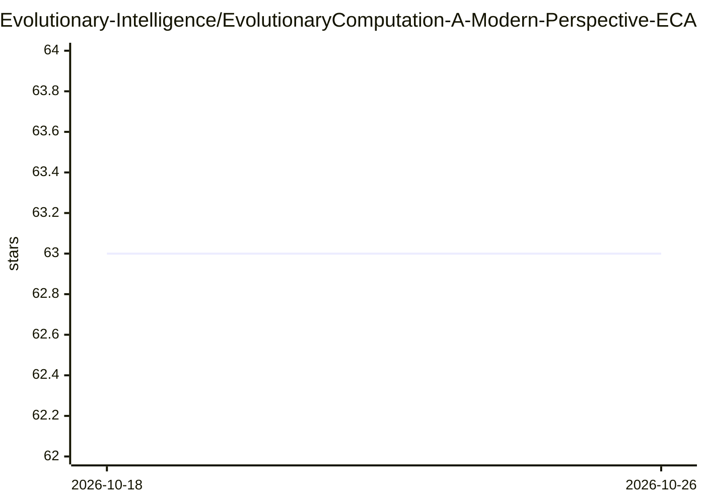

# Evolutionary-Intelligence/EvolutionaryComputation-A-Modern-Perspective-ECAMP

⭐ 63 · CC0-1.0 · 推送 2026-03-19 · [GitHub](https://github.com/Evolutionary-Intelligence/EvolutionaryComputation-A-Modern-Perspective-ECAMP) · 个人维护

**免费在线教材《演化计算：现代视角》，面向学习与研究者**

由 Qiqi Duan 自 2023 年 7 月起撰写的完全开放获取的演化计算（EC）在线书籍，计划于 2027 年 12 月 31 日完成第一版，目前持续更新中。内容覆盖 EC 历史与理论（黑盒优化统一框架、No Free Lunch 定理）、遗传算法、演化策略（CMA-ES/NES/OpenAI-ES）、遗传编程、神经演化（NEAT/PBT）、多目标优化、演化机器人、演化强化学习与元学习等章节，并附各科学领域应用与开源软件资源清单。读者可通过 Issues 与 Pull Request 提出修改建议。

## 筛选速览

| 维度 | 判定 | 备注 |
|---|---|---|
| AI 角色 | `ai-knowledge` | 知识聚合/清单类 |
| 许可风险 | `viral` | CC0-1.0 |
| 部署形态 | `None` |  |
| 模型依赖 | — | README 未给出锁定关系 |
| 硬件要求 | — | 无带数字的原话,不猜 |
| 安装摩擦 | `low` | 无编译、无系统依赖或容器化 |
| 成熟度 | — | 结构信号不足 |

## 能力要点

- 完全开放获取且持续更新的在线书籍
- 覆盖 GA/ES/GP/神经演化/多目标优化等主要分支
- 收录跨学科应用与 Python 开源软件资源清单
- 通过 Issues 与 Pull Requests 接受社区修订

## 适用场景

- 系统学习演化计算各分支的理论与算法
- 查找演化计算在各科学领域的应用与开源工具
- 作为课程或自学教材使用

## 场景标签

`教程课程` · 领域:学习与行业

## 证据(README 行号)

> L5: This is an *online* book for **Evolutionary Computation (EC)**, currently written by *Qiqi
> L7: this **entirely open-access** ONLINE book from July 11, 2023 and is planning to finish its
> L13: ## Contents (Still Actively Updated)

## 星数曲线

2026-10-18 63 → 2026-10-26 63（+0）

---
*卡片 v1 · prompt 1.4 · 生成 2026-10-24 · 置信度 high · 依据 README sha `4d8ccaec6801` · [字段定义](../../DATASET.md)*
