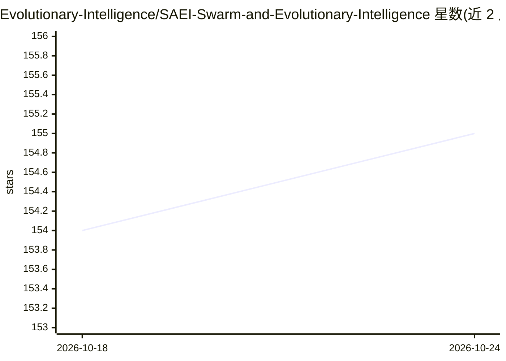

# Evolutionary-Intelligence/SAEI-Swarm-and-Evolutionary-Intelligence

⭐ 155 · TeX · CC0-1.0 · 推送 2026-03-04 · [GitHub](https://github.com/Evolutionary-Intelligence/SAEI-Swarm-and-Evolutionary-Intelligence) · 组织维护

**演化计算与群体智能领域顶刊论文清单，供研究者查阅**

自 2021 年 1 月起持续更新的论文聚合清单，收集演化计算（EC）与群体智能（SI）在 Nature、Science、PNAS、NeurIPS、ICML 等 30 余种期刊与会议上的论文，按发表载体分类组织，另覆盖 EC 专门出版物中的并行/分布式 EC（PDEC）论文。清单声明不对论文价值做判断，仅做收集平台，并提示因仅收录 PDEC 而可能存在偏向。条目按算法族组织，包括遗传算法、蚁群优化、NSGA-II、神经演化、演化机器人等，接收 Issues 与 Pull requests 补充。给演化计算方向的研究者与新人使用。

## 筛选速览

| 维度 | 判定 | 备注 |
|---|---|---|
| AI 角色 | `ai-knowledge` | 知识聚合/清单类 |
| 许可风险 | `viral` | CC0-1.0 |
| 部署形态 | `None` |  |
| 模型依赖 | — | README 未给出锁定关系 |
| 硬件要求 | — | 无带数字的原话,不猜 |
| 安装摩擦 | `low` | 无编译、无系统依赖或容器化 |
| 成熟度 | — | 结构信号不足 |

## 能力要点

- 覆盖 30 余种期刊/会议的 EC 与 SI 论文清单，持续更新
- 按算法族组织条目（GA/ACO/NSGA-II/NeuroEvolution/演化机器人等）
- 通过 Issues 与 Pull requests 社区补充
- 声明不做论文价值判断，仅做收集平台

## 适用场景

- 查找演化计算在顶刊顶会的代表性论文
- 新人了解各算法族的经典与综述文献
- 跟踪并行/分布式 EC 领域论文

## 场景标签

`精选清单` · 领域:学习与行业

## 证据(README 行号)

> L1: # A Growing Paper List of Evolutionary Computation (EC) and Swarm Intelligence (SI) on Top-Tier Publications (e.g., 
> L6: This is an *actively updated* paper list for evolutionary computation (EC)

## 星数曲线

2026-10-18 154 → 2026-10-24 155（+1）

---
*卡片 v1 · prompt 1.4 · 生成 2026-10-22 · 置信度 high · 依据 README sha `2885b4d3915e` · [字段定义](../../DATASET.md)*
