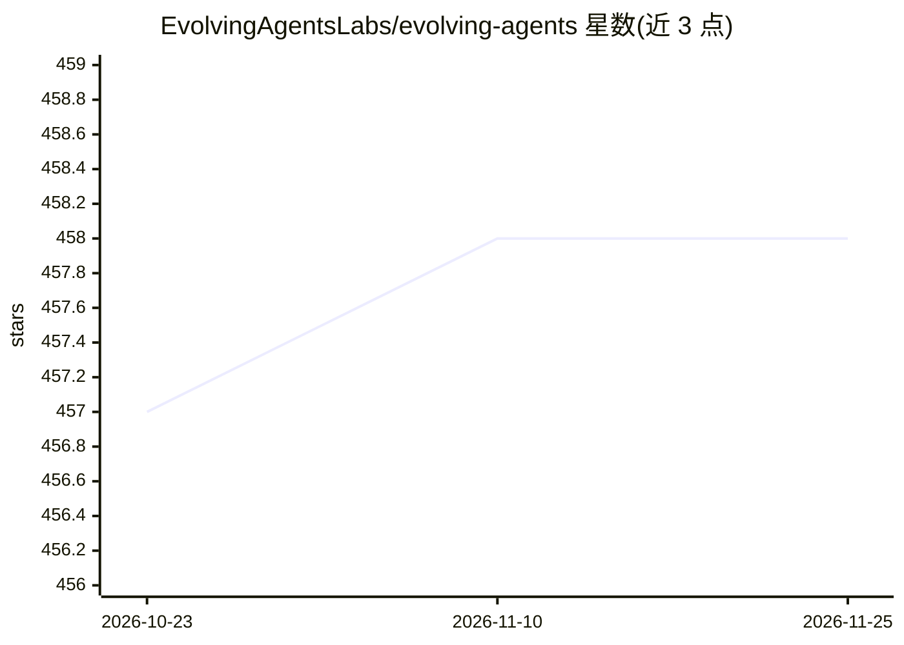

# EvolvingAgentsLabs/evolving-agents

⭐ 458 · TypeScript · Apache-2.0 · 推送 2026-11-06 · [GitHub](https://github.com/EvolvingAgentsLabs/evolving-agents) · [官网](https://evolvingagentslabs.github.io/#director) · 组织维护

**给用 Claude Code 的团队管理代理记忆的指挥代理插件**

以 Claude Code 插件形式运行的『指挥』代理：将团队的 CLAUDE.md、AGENTS.md 与记忆编译为相互链接的规则，代理规划前检索并引用适用的规则；任务可委派给 Claude Code 或本地模型，机密任务仅路由到用户认可的本地机器；纠正后草拟课程（lesson），经 Diff/Accept/Reject 门控保留为可比较、可撤销的版本化变更。内存以纯 Markdown 存于本机。限制：仅在 Claude Code 内运行，成本与安装细节见 packages/director/。

## 筛选速览

| 维度 | 判定 | 备注 |
|---|---|---|
| AI 角色 | `ai-ecosystem` | LLM/agent 周边工具 |
| 许可风险 | `permissive` | Apache-2.0 |
| 部署形态 | `library` | 以包/库形式分发 |
| 模型依赖 | — | README 未给出锁定关系 |
| 硬件要求 | — | 无带数字的原话,不猜 |
| 安装摩擦 | `low` | 无编译、无系统依赖或容器化 |
| 成熟度 | `idea` | |

## 能力要点

- CLAUDE.md/AGENTS.md/记忆编译为链接规则，计划逐步引用所遵循的规则
- 机密任务仅路由到已认可的本地机器，规则在代码中强制执行
- 纠正→草拟课程→Diff/Accept/Reject 门控→版本化可撤销变更
- README 附带多项基准测量，含否定性结果（如 2025 EAT 工具的教训）

## 适用场景

- 让编码代理始终遵循团队自己的约定与决策
- 机密文件只在本地机器处理，规划交给云端模型
- 把每次人工纠正沉淀为可审计、可撤销的规则

## 场景标签

`Agent 记忆` · 领域:Agent 开发

## 证据(README 行号)

> L9: > cleared. When you correct it, it drafts a lesson that you accept or reject. It runs inside **Claude Code** today.
> L55: /plugin install director --marketplace EvolvingAgentsLabs/evolving-agents
> L83: |`packages/director/`|**Active — the project.** The director and its Claude Code plugin|

## 星数曲线

2026-10-23 457 → 2026-11-25 458（+1）

---
*卡片 v1 · prompt 1.4 · 生成 2026-11-25 · 置信度 high · 依据 README sha `32924bdacfd8` · [字段定义](../../DATASET.md)*
