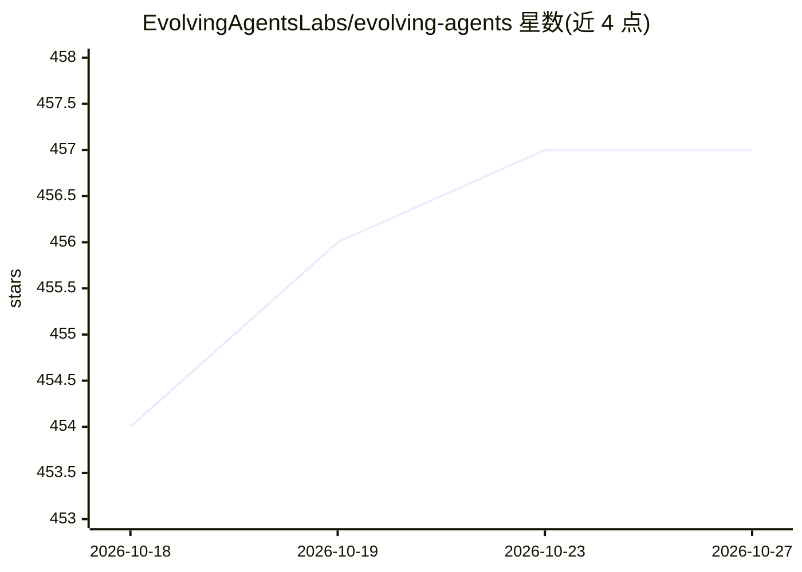

# EvolvingAgentsLabs/evolving-agents

⭐ 457 · TypeScript · Apache-2.0 · 推送 2026-10-25 · [GitHub](https://github.com/EvolvingAgentsLabs/evolving-agents) · [官网](https://evolvingagentslabs.github.io/#director) · 组织维护

**把团队规则编译为链式声明的指挥型 agent，接入 Claude Code/本地模型**

以 Claude Code 插件形式（另有本地 harness）提供的“director”agent：将 CLAUDE.md、AGENTS.md 与 Claude Code 记忆编译为原子化、相互链接的 When/Do/Because 声明，规划时逐条引用所依据的规则；任务完成后通过 lint、探针、守卫与人工确认的门控流程，把经验教训保存为可回滚的版本化补丁（agentvcs）。支持将任务委托给前沿模型、Ollama/llama.cpp 本地模型或任意命令行通道；机密规则以代码而非提示词方式在 lanes.py 中强制执行。需要 Python 3.10+ 与 Claude Code，仅依赖标准库；编译约 60 个文件的成本约为 5 美元。README 依据 14 个场景的测量给出 0.929 对 0.589 的规则遵循率（Sonnet 条件下），并注明 Opus 条件下差距消失、仅余成本差异。对 Anthropic Managed Agents 与 Google Antigravity 的支持为规划中。

## 筛选速览

| 维度 | 判定 | 备注 |
|---|---|---|
| AI 角色 | `ai-ecosystem` | LLM/agent 周边工具 |
| 许可风险 | `permissive` | Apache-2.0 |
| 部署形态 | `library` | 以包/库形式分发 |
| 模型依赖 | local-ok | 支持本地模型 |
| 硬件要求 | — | 无带数字的原话,不猜 |
| 安装摩擦 | `low` | 无编译、无系统依赖或容器化 |
| 成熟度 | — | 结构信号不足 |

## 能力要点

- 将 CLAUDE.md/记忆编译为链式、可引用的规则声明
- 门控式经验学习：lint+探针+守卫+人工确认，输出版本化补丁
- 多通道委托：Claude Code 会话、claude -p、Ollama/llama.cpp 本地模型、任意命令
- 机密性规则以代码形式在 lanes.py 中强制执行而非提示词

## 适用场景

- 我有 CLAUDE.md/AGENTS.md，希望 agent 规划时逐条遵循规则
- 把部分任务改到本地模型执行并让 agent 记住这一偏好
- 团队积累的经验教训以可审计、可回滚的补丁形式沉淀

## 场景标签

`Agent 记忆` `编码 Agent` · 领域:Agent 开发

## 证据(README 行号)

> L10: > statements; plans by walking it; delegates each step to a frontier model, a local model or another harness; and
> L11: > learns from every task through a gated, versioned patch. It ships as a **Claude Code plugin** today and is built
> L112: |local|Ollama / llama.cpp; lora-kernel's specialists|**built** — gemma4:12b plans from recipes at 0.806 vs 0.854, 

## 星数曲线

2026-10-18 454 → 2026-10-27 457（+3）

---
*卡片 v1 · prompt 1.4 · 生成 2026-10-21 · 置信度 mid · 依据 README sha `8849d727967c` · [字段定义](../../DATASET.md)*
