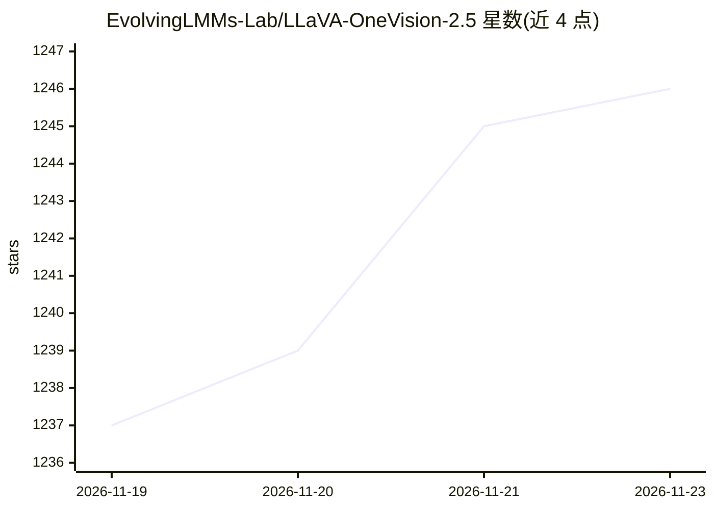

# EvolvingLMMs-Lab/LLaVA-OneVision-2.5

⭐ 1,246 · Python · Apache-2.0 · 推送 2026-11-18 · [GitHub](https://github.com/EvolvingLMMs-Lab/LLaVA-OneVision-2.5) · 组织维护 · 中文 README

**全开源多模态模型训练框架与 LLaVA-OneVision 系列模型发布**

LLaVA-OneVision 家族的完整开源发布仓库：包含 2.5-4B（支持单图、多图、离线与流式视频输入）、2-8B 多模态模型，以及 HEVC 风格的 OneVision-Encoder 视觉编码器。训练管线端到端开放：4 个数据集、编码器权重、训练代码、配置与训练日志均可获取；提供四阶段训练课程与基于编解码块选择的推理方案，并给出 Blackwell/Hopper GPU 上的 SFT 加速预设脚本。面向需要自行训练或复现多模态模型的研究者与开发者。

## 筛选速览

| 维度 | 判定 | 备注 |
|---|---|---|
| AI 角色 | `ai-native` | 本体是模型或模型工具 |
| 许可风险 | `permissive` | Apache-2.0 |
| 部署形态 | `None` |  |
| 模型依赖 | — | README 未给出锁定关系 |
| 硬件要求 | — | 无带数字的原话,不猜 |
| 安装摩擦 | `low` | 无编译、无系统依赖或容器化 |
| 成熟度 | — | 结构信号不足 |

## 能力要点

- LLaVA-OneVision-2.5-4B 单一权重同时支持离线与流式视频两种模式
- OneVision-Encoder 采用 codec 风格块选择，同 token 预算下时间覆盖提升 3 倍
- 数据集、编码器权重、训练代码、配置与训练日志端到端开放
- 提供按 GPU 架构（Blackwell/Hopper）选择的训练加速预设

## 适用场景

- 复现或微调一个图像/视频/空间理解统一的多模态模型
- 训练自己领域的多模态 instruct 模型时参考其四阶段课程与数据配方
- 长视频或流式视频理解场景选型 4B 级开源模型

## 场景标签

`多模态` `微调` `模型训练` · 领域:感知与多模态

## 证据(README 行号)

> L23: **LLaVA-OneVision-2.5** is the latest release of the family. LLaVA-OneVision-2.5-4B-Instruct is a 4B model for sing
> L48: And unlike most "open" releases, *everything* ships alongside them: encoder weights, training code, configs, and fu

## 星数曲线

2026-11-19 1,237 → 2026-11-23 1,246（+9）

---
*卡片 v1 · prompt 1.4 · 生成 2026-11-19 · 置信度 high · 依据 README sha `69f27b895f96` · [字段定义](../../DATASET.md)*
