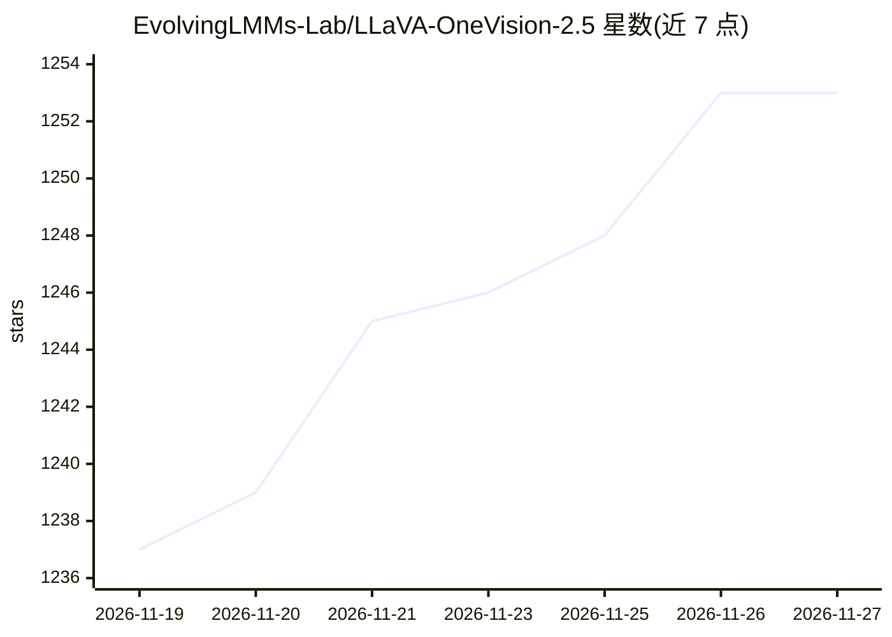

# EvolvingLMMs-Lab/LLaVA-OneVision-2.5

⭐ 1,253 · Python · Apache-2.0 · 推送 2026-11-18 · [GitHub](https://github.com/EvolvingLMMs-Lab/LLaVA-OneVision-2.5) · 组织维护 · 中文 README

**全开源多模态模型家族：图像/视频理解与训练代码全量发布**

LLaVA-OneVision 系列的发布仓库：提供 2.5-4B（支持流式视频，逐帧决定是否输出）与 2-8B 等多模态模型权重，以及配套的 4 个开源数据集、OneVision-Encoder 视觉编码器权重、训练代码、配置与训练日志。训练管线分四阶段课程，从视频字幕引导到长视频与空间推理；另提供基于 GPU 架构预设的训练加速脚本。面向需要自训练、复现或部署多模态模型的研究者与开发者。

## 筛选速览

| 维度 | 判定 | 备注 |
|---|---|---|
| AI 角色 | `ai-native` | 本体是模型或模型工具 |
| 许可风险 | `permissive` | Apache-2.0 |
| 部署形态 | `None` |  |
| 模型依赖 | — | README 未给出锁定关系 |
| 硬件要求 | — | 无带数字的原话,不猜 |
| 安装摩擦 | `low` | 无编译、无系统依赖或容器化 |
| 成熟度 | — | 结构信号不足 |

## 能力要点

- 4B 模型统一单图/多图/视频输入并支持流式视频输出
- HEVC 风格编码器：仅保留运动与残差丰富 patch，同 token 预算下 3 倍时域覆盖
- 端到端开源：数据、编码器权重、训练代码、配置与训练日志
- 提供 Blackwell/Hopper GPU 预设的训练加速脚本（2.2–3.0×）

## 适用场景

- 训练或微调自己的图像与视频多模态模型
- 对流式视频做逐帧的实时理解判断
- 基于公开数据集与日志复现模型训练流程

## 场景标签

`多模态` `模型训练` `微调` · 领域:感知与多模态

## 证据(README 行号)

> L23: **LLaVA-OneVision-2.5** is the latest release of the family. LLaVA-OneVision-2.5-4B-Instruct is a 4B model for sing
> L25: **LLaVA-OneVision-2** is the next-generation release of the LLaVA-OneVision family — a fully open 8B multimodal mod
> L48: And unlike most "open" releases, *everything* ships alongside them: encoder weights, training code, configs, and fu

## 星数曲线

2026-11-19 1,237 → 2026-11-27 1,253（+16）

---
*卡片 v1 · prompt 1.4 · 生成 2026-11-23 · 置信度 high · 依据 README sha `e132b6f90a22` · [字段定义](../../DATASET.md)*
