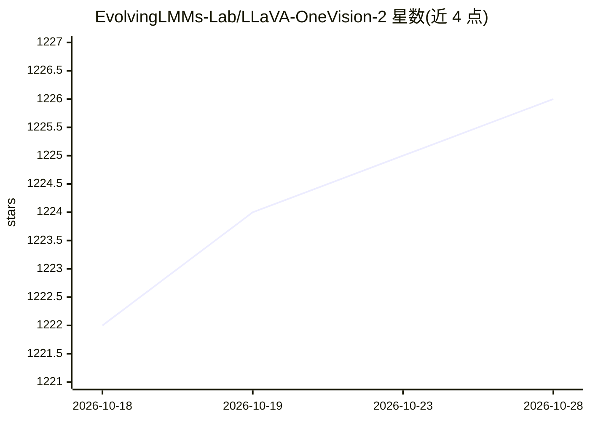

# EvolvingLMMs-Lab/LLaVA-OneVision-2

⭐ 1,226 · Python · Apache-2.0 · 推送 2026-10-28 · [GitHub](https://github.com/EvolvingLMMs-Lab/LLaVA-OneVision-2) · [官网](https://evolvinglmms-lab.github.io/LLaVA-OneVision-2/projects/index.html) · 组织维护

**开源 8B 多模态大模型及全流程训练框架（图像/长视频/空间）**

LLaVA-OneVision 系列的下一代发布：单一 8B 模型统一图像、长视频与 3D 空间理解，原生分辨率、无任务专属适配器。核心机制为 OneVision-Encoder 编码器对齐视觉 Transformer（HEVC 风格，保留 I 帧、仅选运动/残差丰富 patch，同 token 预算下时间覆盖更长）与四阶段训练课程。数据、编码器权重、训练代码、配置与日志全部开放，提供 4B 单机 8×GPU 的 Docker 快速复现脚本（约 340 GB 数据包），基于 Megatron 与 Qwen3 LLM。

## 筛选速览

| 维度 | 判定 | 备注 |
|---|---|---|
| AI 角色 | `ai-native` | 本体是模型或模型工具 |
| 许可风险 | `permissive` | Apache-2.0 |
| 部署形态 | `self-host` | docker 或自建部署 |
| 模型依赖 | — | README 未给出锁定关系 |
| 硬件要求 | — | 无带数字的原话,不猜 |
| 安装摩擦 | `low` | 无编译、无系统依赖或容器化 |
| 成熟度 | — | 结构信号不足 |

## 能力要点

- 单一 8B 模型覆盖图像、长视频、3D 空间、文档/OCR/图表
- OneVision-Encoder 编码器对齐采样：54 token 预算下 18 帧 vs 6 帧
- 端到端开放：4 个数据集、编码器权重、训练代码与完整日志
- 4B 模型单节点 8×GPU Docker 快速启动（含代码 agent 自动化路径）

## 适用场景

- 在自有 GPU 集群上复现或微调多模态模型训练
- 用统一模型处理图像、长视频与空间理解任务
- 研究编码器对齐视觉表征与多阶段训练课程

## 场景标签

`多模态` `模型训练` · 领域:感知与多模态

## 证据(README 行号)

> L31: **LLaVA-OneVision-2** is the next-generation release of the LLaVA-OneVision family — a fully open 8B multimodal mod
> L41: - **Long video** — multi-frame reasoning with efficient codec-aligned inference

## 星数曲线

2026-10-18 1,222 → 2026-10-28 1,226（+4）

---
*卡片 v1 · prompt 1.4 · 生成 2026-10-21 · 置信度 high · 依据 README sha `fed4c9890527` · [字段定义](../../DATASET.md)*
