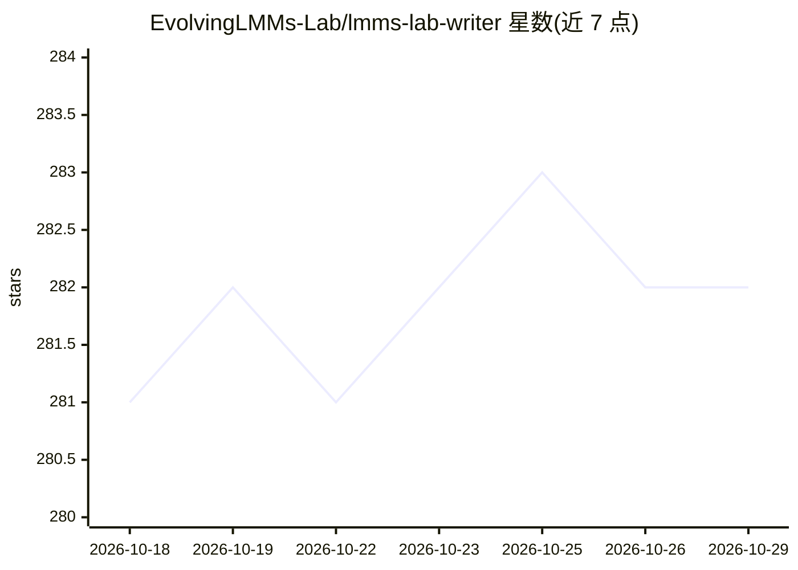

# EvolvingLMMs-Lab/lmms-lab-writer

⭐ 282 · TypeScript · MIT · 推送 2026-06-01 · [GitHub](https://github.com/EvolvingLMMs-Lab/lmms-lab-writer) · [官网](https://writer.lmms-lab.com/) · 组织维护 · 中文 README

**面向科研人员的本地优先 AI LaTeX 编辑器**

基于 Tauri（Node.js + Rust）构建的跨平台（macOS/Windows）LaTeX 编辑器，定位 AI-native 学术写作。内置 OpenCode 面板，AI agent 直接编辑 .tex 文件，兼容 Claude、GPT、Gemini、DeepSeek 及本地 LLM（用户自带 API key）。自动检测并安装轻量 LaTeX 发行版（TinyTeX/MiKTeX/MacTeX/TeX Live），缺失宏包编译时自动安装；支持 XeLaTeX/LuaLaTeX 的完整 Unicode/CJK；侧边栏集成 Git 操作与 GitHub 一键发布。文件全程留在本地，编辑/编译/Git 可离线使用。MIT 许可。

## 筛选速览

| 维度 | 判定 | 备注 |
|---|---|---|
| AI 角色 | `ai-native` | 本体是模型或模型工具 |
| 许可风险 | `permissive` | MIT |
| 部署形态 | `library` | 以包/库形式分发 |
| 模型依赖 | — | README 未给出锁定关系 |
| 硬件要求 | — | 无带数字的原话,不猜 |
| 安装摩擦 | `low` | 无编译、无系统依赖或容器化 |
| 成熟度 | — | 结构信号不足 |

## 能力要点

- 内置 OpenCode 面板，AI agent 实时写入 .tex，兼容任意模型与本地 LLM
- 一键安装管理 LaTeX 发行版，缺失宏包编译时自动补装
- 侧边栏 Git 集成：暂存/提交/diff/推送与 GitHub 一键发布
- XeLaTeX/LuaLaTeX 完整 Unicode 与 CJK 支持，开箱即用

## 适用场景

- 在本地完成 LaTeX 写作、AI 辅助编辑与编译预览全流程
- 撰写中英日韩等多语言论文，避免 CJK 配置问题
- 配合自己的 API key 使用 AI 修改论文，文件不出本机
- 通过侧边栏 Git 完成版本管理与 GitHub 发布

## 场景标签

`AI 写作` · 领域:内容生成

## 证据(README 行号)

> L7: **The AI-native LaTeX editor for researchers who prioritize ideas over syntax.**
> L29: LMMs-Lab Writer is a **local-first, AI-native** LaTeX editor. Your files remain secure on your machine. AI agents a

## 星数曲线

2026-10-18 281 → 2026-10-29 282（+1）

---
*卡片 v1 · prompt 1.4 · 生成 2026-10-22 · 置信度 mid · 依据 README sha `2e15a103fb83` · [字段定义](../../DATASET.md)*
