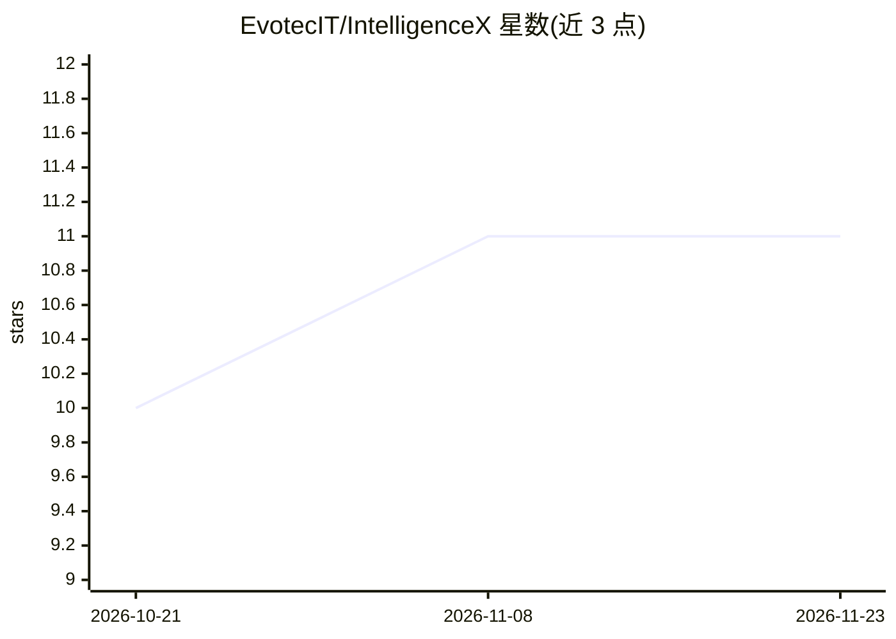

# EvotecIT/IntelligenceX

⭐ 11 · C# · MIT · 推送 2026-11-22 · [GitHub](https://github.com/EvotecIT/IntelligenceX) · [官网](http://intelligencex.dev/) · 组织维护

**.NET 零信任 AI 平台：PR 审查、桌面聊天与工具包**

IntelligenceX 是面向 .NET 的工具集与平台，包含 GitHub Actions AI PR 审查器、Windows 托盘聊天应用 IX Chat、事件日志/文件系统/AD 等工具包、CLI（setup/auth/ops）、.NET 库和 PowerShell 模块。描述中提到它管理 Codex app-server 进程、通过 JSONL 上的 JSON-RPC 通信，并提供 CLI/本地 web 设置向导。运行模型为本地/自托管 GitHub Actions，凭据由用户自持；ADPlayground、TestimoX、ComputerX 三个工具包为私有/商业许可，仅限 IntelligenceX 内部构建使用。

## 筛选速览

| 维度 | 判定 | 备注 |
|---|---|---|
| AI 角色 | `ai-native` | 本体是模型或模型工具 |
| 许可风险 | `permissive` | MIT |
| 部署形态 | `None` |  |
| 模型依赖 | — | README 未给出锁定关系 |
| 硬件要求 | — | 无带数字的原话,不猜 |
| 安装摩擦 | `medium` | 含编译或系统依赖之一 |
| 成熟度 | `idea` | |

## 能力要点

- GitHub Actions AI PR 审查器，支持合并阻塞分诊与内联跟进
- IX Chat Windows 托盘应用，支持 provider/runtime 选择与工具调用（标注为实验性）
- 提供 .NET 库、PowerShell 模块与 CLI 三种开发者接口
- 无后端服务，本地运行，凭据留在用户自有环境

## 适用场景

- 在 GitHub Actions 中自动化 PR 审查流程
- 通过桌面聊天应用做诊断与排查工作流
- 用 .NET 库把私有输入产物转为结构化 AI 输出

## 场景标签

`代码审查` `聊天机器人` `AI 助手` · 领域:编码与开发

## 证据(README 行号)

> L26: AI PR reviewer for actionable findings, merge-blocking triage, and cleaner review loops.
> L3: Zero-trust AI platform with code reviews, desktop chat, tool packs, and developer libraries.
> L41: Windows tray chat app with provider/runtime selection and tool-calling support for diagnostics and investigation wo

## 星数曲线

2026-10-21 10 → 2026-11-23 11（+1）

---
*卡片 v1 · prompt 1.4 · 生成 2026-11-19 · 置信度 high · 依据 README sha `94e63c55909d` · [字段定义](../../DATASET.md)*
