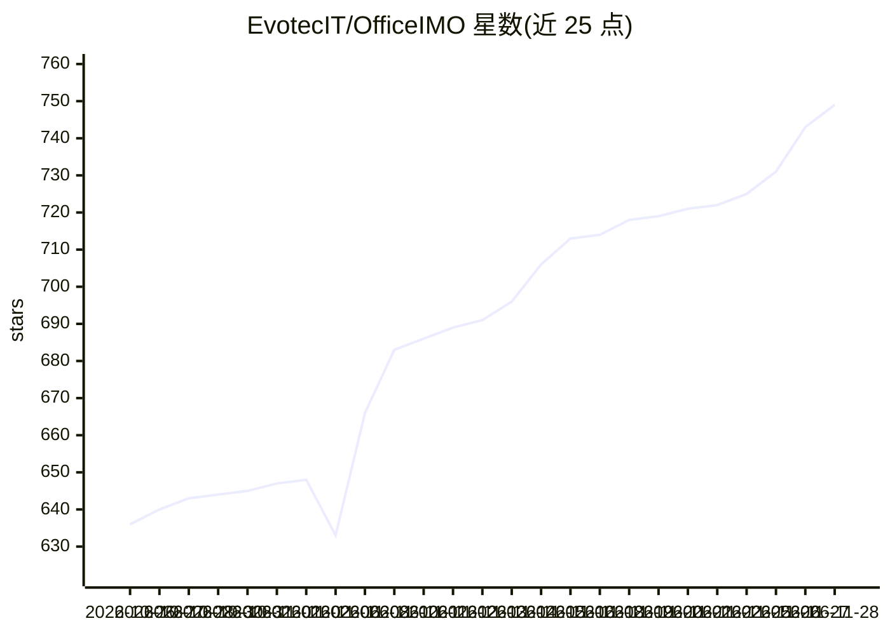

# EvotecIT/OfficeIMO

⭐ 749 · C# · MIT · 推送 2026-11-27 · [GitHub](https://github.com/EvotecIT/OfficeIMO) · [官网](https://officeimo.com/) · 组织维护

**无需 Office/COM 的 .NET 文档创建、转换与读取库**

OfficeIMO 是一组 MIT 许可、不依赖 COM 与 Microsoft Office 的 .NET 库，覆盖 Word、Excel、PowerPoint、PDF、Markdown 等二十余种格式的创建、读取、编辑、转换与提取。按格式拆分 NuGet 包并按需引用；文档从内置主题起步，样式随主题统一。转换结果以 OfficeConversionReport 报告丢失项，批处理支持冲突策略与断点续跑。附带 PSWriteOffice（PowerShell）、officeimo CLI（含 MCP 服务）、OfficeIMO Studio 桌面应用与 Verify 快照测试工具。跨平台运行于 Windows/macOS/Linux 与容器。

## 筛选速览

| 维度 | 判定 | 备注 |
|---|---|---|
| AI 角色 | `ai-enhanced` | 去掉 AI 部分产品仍成立 |
| 许可风险 | `permissive` | MIT |
| 部署形态 | `None` |  |
| 模型依赖 | — | README 未给出锁定关系 |
| 硬件要求 | — | 无带数字的原话,不猜 |
| 安装摩擦 | `medium` | 含编译或系统依赖之一 |
| 成熟度 | — | 结构信号不足 |

## 能力要点

- 按格式拆分的 NuGet 包与转换适配器（OfficeIMO.{Source}.{Target}）
- 内置主题系统（Modern/Classic/Minimal/Boardroom/Dark）统一表格、图表样式
- officeimo CLI 通过 MCP 向 AI Agent 提供转换、提取与搜索服务
- OfficeDocumentReader 支持任意格式的读取、搜索与分块，用于索引和 AI 摄取

## 适用场景

- 在 .NET 服务中批量生成 Word 报告、Excel 图表与 PowerPoint 演示文稿
- 无 Office 环境的容器/CI 中进行文档格式转换
- 将 Office/PDF 等文档读取、分块后送入检索或 AI 摄取流程
- 通过 PowerShell（PSWriteOffice）脚本化操作文档

## 场景标签

`文档解析` · 领域:知识与检索

## 证据(README 行号)

> L7: OfficeIMO creates, edits, reads and converts Word, Excel, PowerPoint, PDF, Markdown and two dozen other document for
> L118: - OfficeIMO.Tool: the `officeimo` command line, from `dotnet tool install --global OfficeIMO.Tool`. It also serves
> L124: Every library targets `netstandard2.0`, `net8.0` and `net10.0`; Windows builds also target `net472`, so .NET Frame

## 星数曲线

2026-10-26 636 → 2026-11-28 749（+113）

---
*卡片 v1 · prompt 1.4 · 生成 2026-11-28 · 置信度 high · 依据 README sha `2dd4ce6cfd2a` · [字段定义](../../DATASET.md)*
