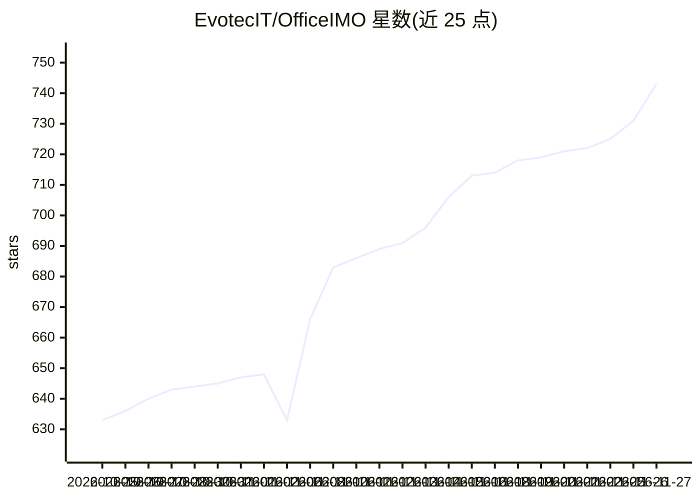

# EvotecIT/OfficeIMO

⭐ 743 · C# · MIT · 推送 2026-11-26 · [GitHub](https://github.com/EvotecIT/OfficeIMO) · [官网](https://officeimo.com/) · 组织维护

**无 COM 依赖的 .NET Office/PDF 文档创建与转换库**

面向 .NET 开发者的文档处理库集合：以同一套 API 形态创建、读取、编辑 Word、Excel、PowerPoint、PDF、Markdown 等二十余种格式，并在格式间相互转换，转换报告通过 HasLoss/FailOnLoss 标注目标格式无法承载的内容。不依赖 Microsoft Office 或 COM，Word/Excel/PowerPoint 基于 Open XML SDK，PDF、Markdown、OneNote、邮件等引擎为自有实现。按格式拆分为独立 NuGet 包以控制依赖体积，附带主题系统、批量转换断点续跑、证书签名与 OCR 扩展包。

## 筛选速览

| 维度 | 判定 | 备注 |
|---|---|---|
| AI 角色 | `ai-enhanced` | 去掉 AI 部分产品仍成立 |
| 许可风险 | `permissive` | MIT |
| 部署形态 | `None` |  |
| 模型依赖 | — | README 未给出锁定关系 |
| 硬件要求 | — | 无带数字的原话,不猜 |
| 安装摩擦 | `medium` | 含编译或系统依赖之一 |
| 成熟度 | — | 结构信号不足 |

## 能力要点

- 同一 API 形态覆盖 Create/Load/Save/SaveAsPdf 等操作
- OfficeConverter 支持文件与文件夹批量转换，含冲突策略与断点续跑
- OfficeDocumentReader 读取、搜索与分块任意格式用于索引与 AI 摄取
- 附 PSWriteOffice PowerShell 模块与 MCP 命令行工具

## 适用场景

- 在 .NET 服务中生成带主题样式的 Word 报告、Excel 表格和 PPT
- 批量将文档转换为 PDF 并检查转换损失
- 为 RAG 管道读取和分块各类文档格式
- 在无 Office 安装的 Linux 容器中处理文档

## 场景标签

`文档解析` · 领域:知识与检索

## 证据(README 行号)

> L7: OfficeIMO creates, edits, reads and converts Word, Excel, PowerPoint, PDF, Markdown and two dozen other document for
> L102: |Read, search and chunk any format for indexing and AI ingestion|OfficeIMO.Reader.All, or one `OfficeIMO.Reader.{F
> L117: - OfficeIMO.Tool: the `officeimo` command line, from `dotnet tool install --global OfficeIMO.Tool`. It also serves

## 星数曲线

2026-10-25 633 → 2026-11-27 743（+110）

---
*卡片 v1 · prompt 1.4 · 生成 2026-11-27 · 置信度 high · 依据 README sha `64c321f0a423` · [字段定义](../../DATASET.md)*
